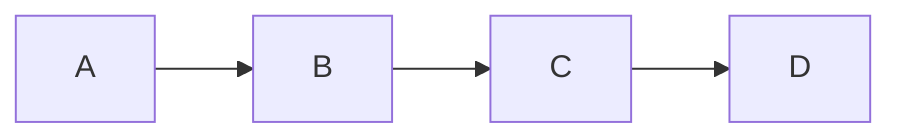
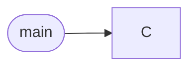
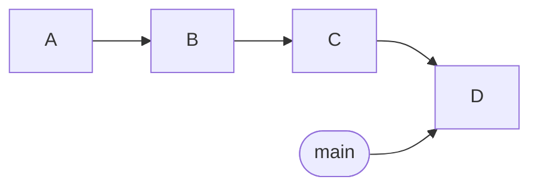
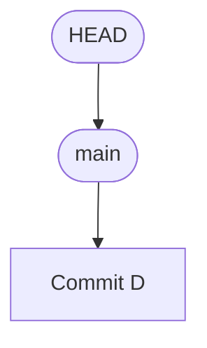

# Session 1: From Saving Files to Building History

**时长：50 分钟**

这一节把更多时间放在设计动机和 Git 的核心模型上。

先理解 **我们为什么需要一种专门的工具来记录代码的变化？**

## Part 1 — The Problem: What Does Version Control Actually Solve?（0–10 min）

### 没有专门工具时的土办法

假设你正在开发一个 Python 项目。

第一天，你写出了一个可以运行的版本。

第二天，你增加了一个功能。

第三天，你修改了一个算法，但程序开始出现 Bug。

你会怎么做？

可以先展示几种常见方案：

```text
project/
├── main.py
├── main_old.py
├── main_new.py
├── main_final.py
├── main_final_v2.py
└── main_final_really_final.py
```

这很有趣，但也揭示了几个实际问题：

- **History：** 我们为什么修改了这段代码？
- **Recovery：** 怎样回到某个确定的历史版本？
- **Comparison：** 两个版本究竟有什么区别？
- **Identity：** 哪个文件才是当前真正使用的版本？
- **Experimentation：** 我想尝试一种新算法，但又不想破坏现有版本，怎么办？

接下来可以展示另一种常见做法：把整个项目复制成多个文件夹。

```text
project_backup_1/
project_backup_2/
project_backup_before_refactor/
project_backup_after_refactor/
```

虽然这样比复制单个文件更可靠，但仍然存在很多问题：

- 不容易知道哪些文件发生了变化。
- 不容易准确追踪每一次修改。
- 不容易比较两个版本之间的差异。
- 随着项目规模扩大，备份会越来越笨重。
- 不同版本之间的关系并不清晰。

### 先从你每天在用的“版本管理”说起

> 飞书文档、金山文档、Word 里那个“历史版本”功能，你用过吗？

你大概率已经享受过“版本管理”，只是没有意识到：

- 飞书 / 金山文档：右上角“历史版本”里躺着每一次自动保存的快照，改坏了可以一键恢复，还能看到谁在什么时候改了什么。
- Word / PPT：自动保存 + 版本历史；在线协作时还能看到别人的修改痕迹。
- 这些功能的共同点：**改错了不怕，随时能回到之前的样子。**

可以现场收集一两个“被历史版本救过”的真实故事，气氛会很好。

> **“历史版本”记录的就是你中间改了什么东西——Git 要解决的正是同一类问题，只不过对象是代码。**

### 那代码为什么不能直接用它们？

看起来在线文档已经把问题解决了，但把同样的需求放到代码项目上，很快会遇到新情况：

- 代码项目不是一个文件，而是成百上千个文件组成的目录树，文档工具管不住整个文件夹的变化。
- 这些版本功能绑定在特定产品上：离线不可用、没法部署在自己的服务器上、也难和开发工具配合。
- 想同时试验两种方案（比如两个算法各写一版再挑好的），文档工具没有“分支”的概念。
- 多人协作改同一个文件时，代码需要能自动合并大部分修改。
  - UNNC Living 断网 在线改了 1000 行代码被覆盖

所以程序员需要一个**属于代码的、不依赖某个云服务的版本管理工具**——版本控制系统（Version Control System）。

### 引出 Git（顺带认识一下 SVN）

版本控制系统不止一种。早年的 CVS、SVN 是**集中式**的代表：所有历史放在一台中央服务器上，提交必须连着它——那也是“离开公司网络就干不了活”的时代。Git 则是**分布式**的代表：每个仓库自带完整历史，两者的具体对比放在第二节讲 GitHub 时展开。

Git 由 Linus Torvalds 在 2005 年为开发 Linux 内核而创建，如今几乎是代码版本管理的事实标准。

它的目标不只是帮你保存文件，还要让你能够：

- 记录项目的历史状态。
- 追踪变化。
- 定位历史版本。
- 在不同开发方向之间切换。
- 在不同的开发历史之间整合修改。

**在线文档的“历史版本”和 Git 解决的是同一类问题——管理变化和历史；只是代码需要一个更专业、更自由的工具。**

---

## Part 2 — Git's Mental Model: Three Places, Three Different Roles（10–25 min）

这一部分介绍最重要的本地工作流。

### 2.1 先认识两个区域：Working Tree 与 Local Repository

从一个动作开始：你修改了 `main.py`，并保存了文件。

此时自然出现第一个需求：**怎么把“现在这个状态”保存成一条以后可以回去的记录？**

回答这个需求，只需要两个区域：

| 区域 | 作用 | 可以怎么理解 |
| --- | --- | --- |
| Working Tree | 当前实际编辑的项目文件 | 你的工作台 |
| Local Repository | 已经保存的提交历史 | 项目的历史档案 |

在 VSCode 中演示“从工作台写入档案柜”，看起来只要一步：

1. 修改 `main.py` 并保存，打开 Source Control view（Activity Bar 中的 Source Control 图标，快捷键 Ctrl+Shift+G）。`main.py` 出现在 `Changes` 列表中——这就是工作区的当前状态（`git status` 回答的问题）。
2. 在视图顶部的消息框输入提交信息（例如 `Add input validation`）。
3. 直接点击 **✓ Commit**。 `Changes` 列表清空；打开提交图，可以看到新出现的提交——工作区的状态被写入了本地仓库。

关键在于：**这两个区域不是同一个东西。**

修改文件并保存，只是改变了 Working Tree；只有点击 **✓ Commit** 创建提交之后，这个状态才进入 Local Repository 的历史。

不过，这个“直接提交”的一步里其实藏着一点细节——先记住这个疑问，下一节从一个新的需求出发揭晓它。

### 2.2 需求出现：只提交一部分修改——引出 Staging Area

这里值得多花一点时间。

假设你修改了三个文件：

```text
main.py
parser.py
README.md
```

其中：

- `main.py` 修复了一个 Bug。
- `parser.py` 增加了新功能。
- `README.md` 只修改了格式。

你希望先提交 Bug 修复，而不把另外两个修改放进去。

如果没有中间的挑选环节，你可能需要手动复制文件、撤销部分修改，或者想办法把修改拆开。

这正是第三个区域存在的原因——**Staging Area（暂存区，也叫 Index）**：准备纳入下一次提交的内容，可以理解为**下一份提交的草稿**。它位于工作台和档案柜之间：先挑选要归档的内容放进草稿，再统一写入历史。

回头再看上一节的演示：点击 **✓ Commit** 时， `Changes` 列表里还有未暂存的内容，VSCode 其实替你多做了一步——先把它们放进暂存区（对应 `git add`），再创建提交（对应 `git commit`）。暂存区一直都在，只是被“直接提交”的便利藏在了幕后；当你需要只提交一部分修改时，它才走到台前。

在 VSCode 中，这只意味着：只点击 `main.py` 旁边的 **+**（只暂存这一个文件），然后输入 `Fix input validation`，点击 **✓ Commit** 提交。

注意，这并不是说其他文件的修改已经消失了。它们仍然可以留在工作区，等待后续处理。

如果需要更细粒度的控制，VSCode 也支持部分暂存：点击 `Changes` 列表中的文件打开 diff view，把鼠标悬停在某个变更块（hunk）上点击 **+**，就能做到只暂存某个文件中的某一小块代码，而不是整个文件。

这相当于按块、按范围挑选要进入下一次提交的内容。

### 2.3 用一个具体例子验证理解

假设 `main.py` 原本是：

```python
print("Hello")
```

你把它改成：

```python
print("Hello, Git")
```

然后在 Source Control view 中点击 `main.py` 旁边的 **+**，完成暂存。

之后，你又把文件改成：

```python
print("Hello, Git!")
```

最后输入提交信息 `Update greeting`，点击 **✓ Commit** 提交。

问题是：提交里会是什么内容？

**答案是：**

```python
print("Hello, Git")
```

因为点击 **+** 的那一刻，当时的文件内容已经进入暂存区，之后的修改不会自动更新暂存区。

这非常适合做一次简短的互动提问。

它能直接帮助学生理解为什么“暂存”和“提交”是两个独立步骤。

### 2.4 需求出现：有些文件不该进入历史

完成几次提交后，很快会发现两类“不该被记录”的东西：

- **环境杂物**——`.DS_Store`、`__pycache__/`、`node_modules/`、编译产物：每次都变，却没有记录价值，只会把历史撑得又大又乱。
- **不想公开的内容**——带密码的配置文件、API key：一旦提交，就进了历史，删掉当前版本也删不掉过去的记录。

这正是 `.gitignore` 存在的原因：在仓库根目录放一个名为 `.gitignore` 的文本文件，写上“不进历史”的名单，Git 就会假装看不见它们：

```text
.DS_Store
__pycache__/
*.pyc
.env
```

在 VSCode 中：资源管理器中新建文件 `.gitignore`（快捷键新建），写好保存——之后 `Changes` 列表里就不会再出现这些文件。GitHub 创建仓库时也提供现成的忽略模板（Python、Node 等），可以直接选用。

顺带回答一个此阶段必然出现的问题：**历史到底存在哪里？** 就在项目根目录那个隐藏的 `.git` 文件夹里——提交、分支、暂存区全部住在里面。日常不需要打开它，更不要手动修改或把它提交进仓库；把它删掉，历史就消失了（只剩工作区里的文件）。

要判断某个文件夹是否是一个 Git 仓库的重要线索也是看本文件夹下是否有一个 `.git` 目录。如果你想把一个普通文件夹变成一个被 Git 追踪历史的特殊文件夹，只需要在该目录下运行一个 Git 的内置命令 `git init` 或者在 vscode 打开一个文件夹之后在 `Source Control` 面板点击 `Initialize Repository` 按钮即可。

### 本部分的核心结论

```text
Edit → Stage → Commit
```

它们分别对应：

```text
修改文件 → 选择提交内容 → 创建历史记录
```

在 VSCode 中，这三步分别对应：在编辑器中修改文件 → Source Control view 中点击 **+** → 输入提交信息后点击 **✓ Commit**。

建议让学生把这个模型记住，而不是先记住十几个操作。

---

## Part 3 — What Is a Commit, Really?（25–33 min）

这一部分只回答一个问题，点到为止，不展开内部实现。

先问学生：

> 当你在 VSCode 中点击 **✓ Commit** 创建一次提交时，Git 究竟保存了什么？

很多初学者会认为 Git 主要记录每一次修改的操作，例如：

```text
1. 在第 3 行增加一个函数
2. 删除第 5 行
3. 修改变量名
```

但 Git 的做法更简单直接：**每次提交，保存项目在这一刻的完整状态（一份快照），再附上一条说明。**

一句话概括：

> **一次提交 = 一份项目快照 + 一条“这次谁改了什么、为什么改”的说明。**

例如，Commit A 记录的是：

```text
main.py
utils.py
README.md
```

这三个文件在那一刻的样子。你修改了 `main.py` 后创建 Commit B，它记录的又是新一刻的完整样子。

每次提交还会自动附上：作者、时间、你填写的提交说明，以及一个像指纹一样的提交 ID（比如 `a1b2c3d`）。

提交 ID 来自一次**哈希（hash）运算**：把内容交给一个固定的函数，算出一串定长的字符串。记住哈希的三个特性即可：

- **同样的内容，算出的 ID 一定相同。** 所以两处出现同一个 ID，就说明内容完全一致。
- **内容哪怕只改一个字符，ID 也会整个变掉。** 所以 ID 没变，内容就没被悄悄改动过——相当于自带“防篡改封条”。
- **没法从 ID 反推出内容。** 它是内容的“指纹”，不是“压缩包”。

顺带一提：Git 传统上使用 SHA-1（40 位十六进制），新仓库也支持 SHA-256——知道名字即可。

至于快照在磁盘上具体怎么存、相同的文件如何复用，属于 Git 的内部实现，这节课刻意不讲。你只需要记住：

> Git 记录的是“项目每个时刻长什么样”，而不是“你敲过的每一步操作”。

---

## Part 4 — History, References, and "Where Am I"?（33–41 min）

这一部分为第二节做铺垫，只保留三个最实用的结论：历史是一条链、分支是一张书签、HEAD 标记你现在的位置。

### 4.1 提交连成一条历史

每创建一次提交，它都会接在上一次提交的后面，于是项目历史像一条链一样不断向前生长：



一句话概括：**每个提交都记得自己的“上一个”是哪个提交，所以历史能一路追溯回起点。**

到目前为止，这条线都是直的。它什么时候会“岔开”？岔开之后又怎么合回来？——这是第二节的开场问题，先卖个关子。

### 4.2 分支：一张写着“当前进展”的书签（Reference）

仓库里可以同时存在很多提交，Git 需要一种方式标记“值得指认的那些提交”。答案是引用（reference）：**一张贴在某个提交上、可以随时挪动的“书签”**。

例如：



`main` 就是这样一个引用，此刻指向提交 C。

当你在 `main` 上创建新提交 D 时，Git 不需要改动任何历史，只要把这个引用移动到 D：



这也是 Git 中分支非常轻量的原因之一。

分支并不是把整个项目复制一份，而是一个指向提交的可移动引用。

一句话：**分支就是贴在某个提交上的书签，创建和移动它几乎零成本。**

### 4.3 还剩一个问题：你本人现在在哪个分支上？

分支和引用都可以有很多个，于是还剩最后一个问题：**你本人现在站在哪个分支上？** 换句话说，下次点击 **✓ Commit** 创建的提交会落到哪个分支？

Git 用一个特殊标记回答：`HEAD` 表示当前检出的版本位置，通常通过当前分支引用间接指向一个提交。

例如：



如果你切换到另一个分支，`HEAD` 的位置也会随之改变——VSCode Status Bar 左下角显示的分支名，反映的正是 `HEAD` 当前所在的分支。

一句话：**HEAD 就是“你现在站在哪”的标记。**

这里可以只介绍概念，不必深入 detached HEAD 等特殊状态。

### Session 1 核心结论

- 一次提交 = 项目快照 + 一条“改了什么”的说明。
- 提交连成历史，分支是书签，HEAD 标记你现在的位置。

记住这三句话，第二节的一切都会顺理成章。

---

## Part 5 — 动手环节：登录 GitHub，完成第一次提交（41–50 min）

这一部分留出真正的上机时间，目标只有一个：**每个人现场完成自己的第一次 Commit。**

### 5.0 前置检查：电脑上还没装 Git 怎么办（约 2 分钟）

大部分同学打开 VSCode 后 Source Control view 就能直接用；如果它提示 “Download Git” 或弹出 “Git not found. Would you like to install Git?”，说明系统里还没有 Git。

1. 直接点击提示中的 **Download Git** / **Install** 按钮，按提示一步步装完；macOS 若弹出“需要安装命令行开发者工具”的对话框，点“安装”即可，里面自带 Git。
2. 装完后按提示**重启 VSCode**。
3. 重新打开 Source Control view，不再出现该提示，就说明 Git 已就绪。

### 5.1 准备：在 VSCode 中登录 GitHub（约 3 分钟）

1. 点击 VSCode 左下角的账户头像图标 → “Sign in with GitHub”。
2. 浏览器会打开 GitHub 授权页面，登录并点击 **Authorize visual-studio-code**。
3. 回到 VSCode，账户图标处显示你的 GitHub 用户名/头像，即登录成功。

登录之后，VSCode 可以直接以你的身份发布、克隆仓库——第二节推送时不再需要现场折腾认证。

### 5.2 创建仓库并完成第一次提交（约 5 分钟）

1. 在电脑上你喜欢的位置新建文件夹 `git-practice`，在 VSCode 中打开：文件 → 打开文件夹。
2. 打开 Source Control view，点击“Initialize Repository”按钮。
3. 新建 `main.py`，写一行 `print("hello, git")` 并保存——文件立刻出现在 Source Control view 的 `Changes` 列表里。
4. 消息框输入 `Initial commit`，点击 **✓ Commit**。
5. 打开提交图（**···** → “View Commit Graph”），找到自己刚创建的第一个提交；点击 `Changes` 里的文件还能打开 diff view。

### 5.3 再来一次，体会暂存区（约 1 分钟，时间允许时）

- 修改 `main.py`，再新建一个 `notes.md`。
- 这次先只点 `main.py` 旁的 **+** 暂存并提交，再单独暂存提交 `notes.md`。
- 提交图里出现两次提交——这就是“自己挑选下一次提交包含什么”。

### 5.4 下课前三个问题

1. 为什么“暂存”和“提交”是两个不同的步骤？
2. 一次提交里保存的是什么——是你的每一步操作，还是项目那一刻的样子？
3. 分支和 HEAD 分别是什么？

最后用一句话收束：

> Git records snapshots, connects them into history, and gives us ways to navigate that history.

走动帮同学排障，常见问题：没装 Git（按 5.0 点提示按钮装好并重启）、GitHub 没登录成功、文件夹没有在 VSCode 中打开、误把整个主目录初始化成仓库。没跟上的同学可以课后照着 5.0–5.2 补齐，或到仓库 issue 提问。
