# Session 2: From Branches to Distributed Collaboration

**时长：50 分钟**

从一个实际的开发需求出发：

> 你已经有一个可以运行的版本。现在，你想尝试一种新算法，但不想破坏现有代码。

由此自然引出 branch、merge、冲突，以及 remote。

讲义按 PPT 分页：每个 `##` 是一个 Part，每个 `###` 对应一页幻灯片（编号与标题一致，顺序与 deck 相同）。

## Part 1 — Graph and Branches（0–8 min）· slides 16–17

### 16 · When history forks

第一节里，我们看到的提交历史都是一条直线：新提交接在旧提交后面，一路向前。

但真实的开发常常需要**几条线同时推进**：一条保持稳定可用，另一条拿去做试验。一旦几条线从同一个版本出发各自延伸、之后又汇合，历史就不再是一条线，而是一张会**分叉和汇合的图（Graph）**——像家谱，也像河流的分叉与合流：

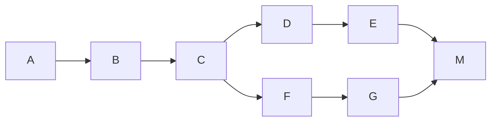

第二节的所有主角——分支、合并、冲突、撤销——都是在这张图上发生的故事。先从“为什么需要岔出一条线”讲起。

### 17 · Branch: try safely, switch fast

没有分支会发生什么？假设项目历史如下：

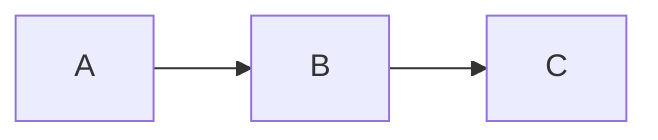

现在你想增加一个新功能。一种方法是在当前版本上直接修改：

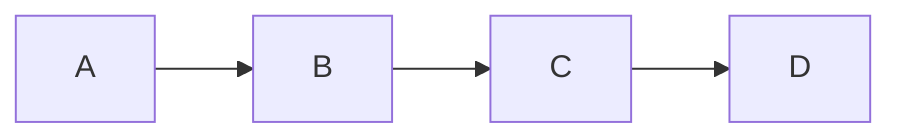

但如果你不确定这个功能能否成功，就会面临一个问题：

**如何在保留现有稳定版本的同时，安全地尝试新方案？**

如果每次尝试都复制整个项目，会出现之前讨论过的问题。Git 的分支允许你在现有历史基础上创建另一条开发路径。

满足这个需求的方案，就是在现有历史基础上分出一条可以独立推进的开发路径。例如：


这个图表示：

- `main` 仍然指向 C。
- `feature` 指向 E。
- 两个分支共享之前的历史，但后续提交可以不同。

历史在这里第一次“岔开”——正是前奏里那张图的最小版本：一条线停在 C，另一条继续走到 E。

分支的重点是：**允许不同的开发路径独立推进，而不必复制整个仓库。**

在 VSCode 中，分支操作集中在**Status Bar 左下角的当前分支名**上：

- 点击分支名，在弹出的下拉列表中选择已有分支，即可切换到该分支。
- 选择“Create New Branch...”，输入 `feature` 并回车，一步完成“创建 + 切换”。

这里可以解释一个容易被误解的地方：

**创建分支本身不会创建一个新的提交，也不会立即复制一份项目。**

它主要是在 Git 中创建一个新的分支引用。可以把这看作一个非常轻量的操作。

## Part 2 — Merge（8–18 min）· slides 18–20

分支解决了独立开发的问题，但当功能开发完成后，我们往往需要把修改整合起来。这就引出了 merge。

### 18 · Merge A: fast-forward

一个简单的合并场景。假设：

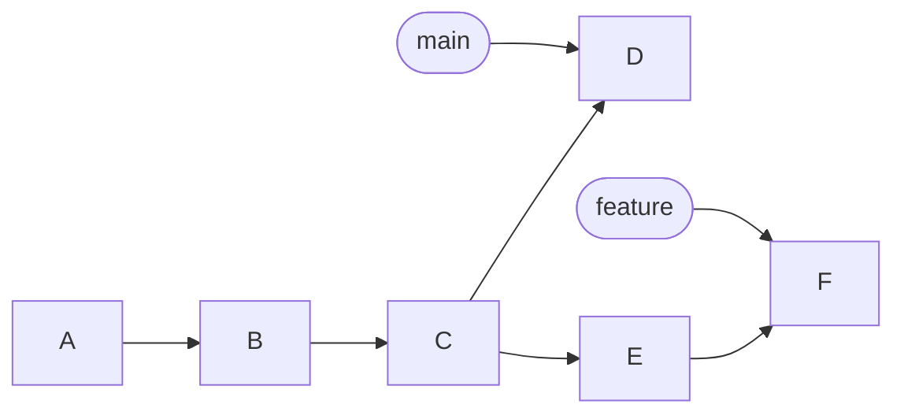

其中：

- `main` 指向 D。
- `feature` 指向 F。
- C 是两个分支的共同祖先。

现在你希望把 `feature` 的开发成果合并到 `main`。Git 会根据提交历史和文件内容来判断如何完成整合。

两种常见情况之一：**Fast-forward**。

假设 `main` 仍然指向 C，而 `feature` 已经前进到 E：

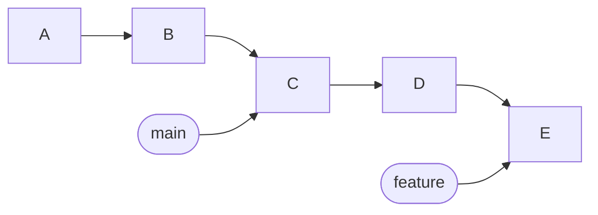

当切换到 `main` 并合并 `feature` 时，如果 `main` 没有独立的新提交，Git 可以直接把 `main` 引用移动到 E。

这就是 fast-forward。它不需要创建新的合并提交。

### 19 · Merge B: three-way

两种常见情况之二：**Three-way merge**。

如果 `main` 和 `feature` 都产生了独立提交：

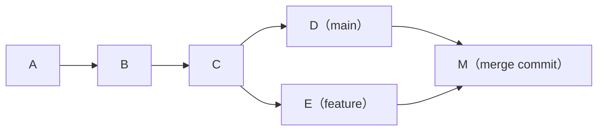

Git 可以使用三个版本进行合并：

1. 共同祖先 C。
2. `main` 上的版本 D。
3. `feature` 上的版本 E。

这就是三方合并的基本思路。

Git 不只是把两个文件直接拼在一起，而是利用共同祖先和两个分支的变化来尝试整合修改。

### 20 · Conflicts are not errors

为什么会发生 Merge Conflict？现在假设两个分支都修改了同一个函数：

```python
def calculate_price(price):
    return price * 1.0
```

`main` 修改为：

```python
def calculate_price(price):
    return price * 1.1
```

`feature` 修改为：

```python
def calculate_price(price):
    return price * 1.2
```

Git 无法确定开发者究竟希望采用哪一种业务逻辑。因此，它可能产生冲突，需要开发者决定最终结果。

关键点是：

**冲突不一定意味着 Git 失效，而可能意味着 Git 缺乏足够的信息来判断开发者的真实意图。**

Git 可以处理大量结构清晰、没有歧义的修改；但它无法仅凭代码差异理解所有业务语义。

冲突是否只会发生在同一行？不一定。

同一行的不同修改很容易产生冲突，但不同位置的修改也可能发生冲突。例如：

- 一方删除了某个函数，另一方修改了这个函数。
- 一方重命名文件，另一方修改了旧文件。

这里可以把冲突理解为：**自动整合无法可靠地确定最终结果，需要人为介入。**

## Part 3 — Undo（18–24 min）· slides 21–22

这一部分很适合用来解释 Git 的历史模型有什么实际价值。

学生可能会问：

> 如果我提交了一次错误修改，能不能撤销？

答案是可以，但不同的撤销操作针对的是不同层次。

### 21 · Two small undos

先区分三个问题：

| 问题 | VSCode 中的操作 |
| --- | --- |
| 我修改了文件，但还没有暂存，想丢弃这些修改 | Source Control view 中悬停该文件 → 点击 **↩**（Discard Changes） |
| 我已经暂存了修改，但还没有提交，想取消暂存 | 在“Staged Changes”中点击 **−**（Unstage Changes） |
| 我刚提交了一次错误修改，想把这次提交收回来 | Source Control view **···** → Commit → **Undo Last Commit** |

### 22 · Undo Last Commit

对于最后一种情况，VSCode 内置的 **Undo Last Commit** 最适合初学者：它把最近一次提交原样“退回”——提交从历史里消失，改动回到 “Staged Changes” 列表，可以修改后重新提交。

例如，D 是一次错误提交：

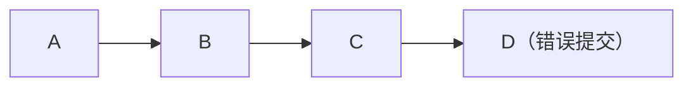

执行 **Undo Last Commit** 后，D 从历史中收回，历史回到 C；D 的改动完好地待在 “Staged Changes” 里等你处理：


一句话：**撤销提交不等于丢改动——只是把“提交”这层包装退掉，内容回到暂存区。**

需要提醒边界：Undo Last Commit 只收回**最近一次**提交，最适合还没有 push 的场景。已经 push 的提交技术上也能收回——但改写完再推送需要 **force push**（带 `--force` 的推送），会打乱基于旧历史协作的人，初学阶段不推荐；用一次新的提交去修正错误更稳妥。

那更早的、已经推送的提交呢？可以简单提及，不必展开操作细节：

- 更早的错误提交：用**新的提交**把改错的内容改回来，不改写历史。
- 背后更精细的工具（revert、reset 等）这节课不展开，以后需要时再学。

> 一条够用的规则：**没推送的提交可以随意收回；已推送的提交也能改，但再次推送要加 `--force`（force push），会影响他人协作——不推荐。**（VS Code 里如何开启 force push，见 Slides 文末的 APPENDIX 页。）

## Part 4 — Distributed（24–32 min）· slides 23–25

这一部分是从本地 Git 过渡到 GitHub 的关键。

先提出一个问题：

> 如果 Git 已经能在本地保存历史，为什么还需要 GitHub？

### 23 · Git is not GitHub

可以先给出一个简单对比：

| Git | GitHub |
| --- | --- |
| 一个版本控制系统 | 一个提供 Git 仓库托管等服务的平台 |
| 可以在本地运行 | 可以托管远程仓库 |
| 可以记录提交、管理分支、整合历史 | 可以保存远程仓库，便于跨设备或多人共享 |
| 不要求必须使用 GitHub | 可以托管 Git 仓库，但不等于 Git 本身 |

例如，你完全可以在没有网络的情况下，只用 VSCode 完成：

1. 打开 Source Control view，点击“Initialize Repository”按钮，在当前文件夹创建仓库。
2. 在 Source Control view 点击“Changes”标题栏的 **+**（Stage All Changes）。
3. 输入提交信息 `Initial commit`，点击 **✓ Commit** 提交。

这些操作不需要 GitHub。因此，GitHub 不是 Git 的必要组成部分。

### 24 · Distributed: Git vs SVN

为什么 Git 是分布式版本控制系统？看一个具体场景。假设有两名开发者：

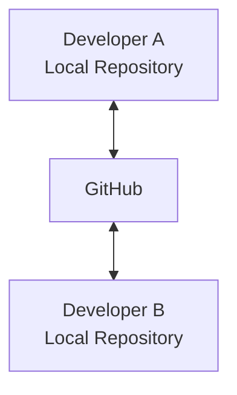

A 和 B 都可以在本地创建提交、查看历史、切换分支——哪怕此刻完全没有网络。

为什么做得到？关键区别是：**每个正常克隆得到的仓库都自带完整的提交历史，而不只是文件的一份副本。** 他们各自手里都有一个功能完整的仓库。

这也正好回答了第一节埋下的问题：Git 和更早的 SVN 有什么区别？

| | SVN（集中式） | Git（分布式） |
| --- | --- | --- |
| 历史存在哪里 | 只在中央服务器 | 每个克隆都有完整历史 |
| 提交需要联网吗 | 必须连着中央服务器 | 不需要，本地随时提交 |
| 中央服务器宕机 | 所有人无法提交、无法协作 | 每人手里仍有完整仓库，之后随便挑一份同步 |
| 典型协作方式 | 围绕中央仓库转 | 任意仓库互相同步，GitHub 是最流行的“汇合点” |

一句话：**SVN 的提交和历史都在中央服务器上——连不上它（服务器挂了，或者你人在飞机上），就提交不了、也查不了历史；Git 的完整历史就在你手里——飞机上照样提交。**（较真备注一：SVN 离线时编辑文件、对比改动、恢复单个文件仍然可行，这些只依赖本地工作副本；离不开服务器的是 commit、update、log、branch 等关键操作。较真备注二：浅克隆等特殊配置下 Git 本地不一定有全部历史，这里按普通完整克隆讨论。）

### 25 · Remote: who do I sync with?

需求出现：本地仓库怎么记住“要和谁同步”？

本地有了完整历史之后，新需求出现了：把提交发布到 GitHub，或者拿到别人的更新。这要求本地仓库先记住“要打交道的远程仓库是谁、地址是什么、给它叫什么名字”。

这就是 remote：一条命名的远程仓库连接配置。

这些都会在结课练习（Part 7）里亲眼看到：clone 时 Git 自动把来源仓库配置为名为 `origin` 的 remote；选择 fork 推送时，VS Code 又自动把你自己 GitHub 账号下的仓库关联了进来——全程没有一步手动的“配置远程”操作。

这里要强调：

**`origin` 只是一个常见的默认名称，不是 GitHub 的特殊关键字。**

一个 remote 可以关联到 GitHub，也可以关联到公司内部的 Git 服务器，甚至是另一台电脑上的仓库。

## Part 5 — Push, Fetch, Pull, Stash（32–45 min）· slides 26–29

这是远程部分最重要的知识点。

建议把它讲成三个先后出现的问题，而不是让学生死记操作：

1. 我在本地完成了提交，怎么发布出去？（push）
2. 远程有没有别人的新提交？（fetch）
3. 远程更新拿到后，怎么整合进当前分支？（pull）

### 26 · Push: publish your commits

第一个问题：我在本地完成了一些提交，怎么让别人、让 GitHub 也看到？

在 VSCode 中：第一次推送时，点击 Status Bar 的“Publish Branch”；之后可以点击 “Sync Changes”，或通过 Source Control view **···** → “Pull, Push” → “Push”。

概念上，它会将远程仓库尚未拥有的必要 Git 对象传过去，并更新远程引用，但具体更新还会受到目标分支、权限和服务器规则等因素影响。

如果推送被拒绝、而你确实需要覆盖远程历史（例如自己整理过提交），开启 force push 的方法见 Slides 文末的 APPENDIX 页。

### 27 · Fetch: look, don't merge

第二个问题：别人可能已经往远程推送了新提交，我怎么知道？

在 VSCode 中：Source Control view **···** → “Pull, Push” → “Fetch”。

它会获取远程的新提交和相关对象，并更新相应的远程跟踪引用。

例如：

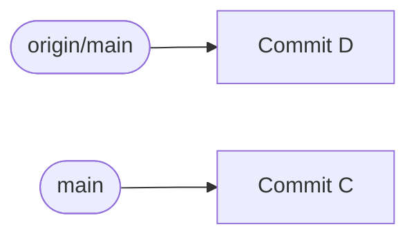

执行抓取后，Git 可能发现远程 `main` 已经前进到 D。

此时，本地的 `origin/main` 会更新到 D，但本地 `main` 不会因此自动移动。

这说明：

**获取远程更新，不等于把远程更新直接整合进当前工作分支。**

### 28 · Pull: fetch and integrate

第三个问题：远程的更新拿到了，怎么把它整合进我当前的工作分支？

在 VSCode 中：Source Control view **···** → “Pull”，或直接点击“Sync Changes”按钮（一次完成拉取 + 推送）。

在常见配置下，拉取可以理解为：

```text
抓取（fetch） + 整合（integrate）
```

后半部分通常是 merge，也可以根据配置使用 rebase。

例如：

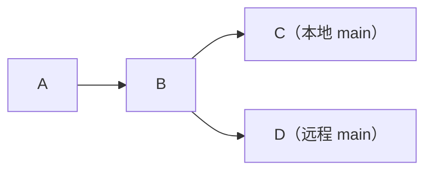

执行拉取后，Git 会先获取远程更新，再按照配置尝试整合远程历史。

如果本地没有独立的新提交，可能只是 fast-forward。

如果本地和远程分别产生了提交，则可能需要 merge 或 rebase。

### 29 · Stash: clear the desk

需求出现：拉取时手里还有没打包的修改。

上面说的是“本地多了几个提交”，还有第三种更常见的情况：远程有更新要拉，而你桌面上**还摊着一叠没提交的修改**——改到一半的代码、临时调试的打印。这时直接 Pull，Git 可能直接拒绝：同一个文件两边都动过，它不敢硬叠。

用搬箱子类比：

- 本地仓库是一摞**已经封好的箱子**（提交）；远程寄来了新箱子，要叠到你这摞上（pull）。
- 可你的箱子上还摊着**一叠没打包的衣服**（未提交的修改）——新箱子没地方放。
- **Stash** 就是那块“临时防尘布”：先把这叠衣服整个收起来放到一边（存入 stash），桌面瞬间干净。
- 叠好远程来的新箱子（pull）之后，再把衣服**原样倒回**桌上（stash pop）——接着干活，什么都没丢。

VSCode 操作：

1. Source Control view **···** → Stash → **Stash**（或 **Stash (Include Untracked)**，把新建但未跟踪的文件也一起收走）；备注一句更好认，如 `wip: 登录页改到一半`。
2. 正常 Pull。
3. **···** → Stash → **Pop Latest Stash**——修改回到工作区，stash 条目同时清掉（用 **Apply Latest Stash** 则保留备份）。

一句话：**stash = 把没打包的修改整叠收起来，腾出桌面处理远程更新，完事再原样放回。**

边界提醒（点到为止）：stash 是临时存放处，不是第二个暂存区——别把重要工作长期留在里面；放回时如果和拉下来的修改改到了同一处，照样走 Part 2 学过的冲突流程。

一个适合课堂的记忆方法：

| VSCode 中的入口 | 核心含义 |
| --- | --- |
| Publish Branch / Push | 把本地提交发布到远程 |
| Fetch | 获取远程更新，但不自动整合进当前分支 |
| Pull / Sync Changes | 获取远程更新，并尝试整合 |
| Stash / Pop | 收起未提交的修改腾出桌面，完事原样放回 |

需要提醒学生：不要把 Pull 理解为简单地“下载文件”。Git 处理的是仓库对象、引用和提交历史之间的同步与整合。

## Part 6 — Putting It Together（45–47 min）· slide 30

### 30 · The whole picture

最后用一张图将整门课的内容串起来。

可以用以下流程总结：

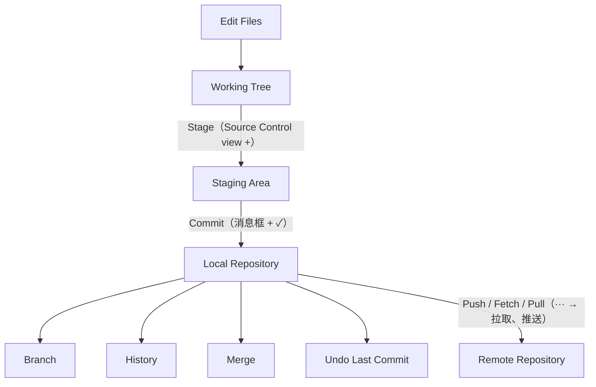

最后强调三点：

1. **Git 的核心是管理历史。** 文件是工作对象，提交和提交之间的关系构成了历史。
2. **Git 的分支是轻量的历史引用。** 它使不同的开发路径可以独立推进，再通过合并整合。
3. **Git 是分布式的。** GitHub 提供远程仓库托管和共享能力，但 Git 本身就可以在本地独立工作。

## Part 7 — 结课练习（47–50 min）· slide 31

### 31 · Clone this repo, push to yours

课程的最后一件事：把今天学到的整条链路亲手走一遍——把**本课程的内容仓库**变成你 GitHub 主页上的一个仓库。

1. **Clone**——打开 Command Palette（Windows：`Ctrl+Shift+P`，macOS：`Cmd+Shift+P`），输入 “Git: Clone”，粘贴仓库地址 `https://github.com/CompPsyUnion/2627-weekly-session.git`，选择本地存放位置，VS Code 会完成克隆并提示打开。此时 Git 已自动把来源仓库配置为名为 `origin` 的 remote。
2. **改动并提交**——在仓库里做一个小改动（例如在任意 Markdown 文件里加一行自己的名字），在 Source Control view 中暂存并提交。
3. **Push**——点击 “Sync Changes”（或 **···** → “Push”）。你并没有原仓库的写权限，VS Code 会提示没有推送权限、询问是否创建 fork——点击 **Create Fork**。VS Code 会在你的 GitHub 账号下自动创建 fork 并完成推送。
4. **验收**——打开浏览器访问 `github.com/<你的用户名>`，在仓库列表里找到 `2627-weekly-session`，确认刚才的提交已经出现在你自己的仓库里。

如果还没登录 GitHub（Session 1 动手环节没完成的同学），推送时 VS Code 会先弹出浏览器要求授权，照做即可。

这条链路——clone → 改动 → commit → fork → push——正是向开源项目提交贡献的标准入口，仓库的 CONTRIBUTING.md 描述的就是这套流程。课程到这里正好闭环：Session 1 的第一次提交留在你自己的电脑上，最后这次提交去了你自己的 GitHub。
