<style>
/* deck preference: side-pinned images vertically centred and never capped */
section.side img {
  top: 50%;
  transform: translateY(-50%);
  max-width: none;
  max-height: none;
}
</style>

<!-- Mermaid loader: renders fenced ```mermaid blocks as diagrams in the
     code-block card, CPU brand colors. Works in CLI exports and the HTML
     export; the VS Code preview (no scripts) shows the source card. -->

<script src="https://cdn.jsdelivr.net/npm/mermaid@11/dist/mermaid.min.js"></script>
<script>
mermaid.initialize({
  startOnLoad: false,
  theme: 'base',
  themeVariables: {
    fontFamily: "'Noto Sans SC','PingFang SC','Hiragino Sans',sans-serif",
    fontSize: '24px',
    primaryColor: '#fdfaf0',
    primaryBorderColor: '#111111',
    primaryTextColor: '#111111',
    secondaryColor: '#f9dd74',
    secondaryBorderColor: '#111111',
    secondaryTextColor: '#111111',
    tertiaryColor: '#fdf6dd',
    tertiaryBorderColor: '#e3d5a8',
    tertiaryTextColor: '#111111',
    lineColor: '#111111',
    textColor: '#111111',
    edgeLabelBackground: '#f9dd74',
    clusterBkg: '#fdf6dd',
    clusterBorder: '#e3d5a8',
    actorBkg: '#fdfaf0',
    actorBorder: '#111111',
    actorTextColor: '#111111',
    actorLineColor: '#a3a3a3',
    signalColor: '#111111',
    signalTextColor: '#111111',
    noteBkgColor: '#f9dd74',
    noteBorderColor: '#111111',
    activationBkgColor: '#f9dd74',
    activationBorderColor: '#111111',
    sequenceNumberColor: '#111111',
    taskBkgColor: '#f9dd74',
    taskBorderColor: '#111111',
    taskTextColor: '#111111',
    todayLineColor: '#111111',
    gridColor: '#a3a3a3'
  }
});
const renderMermaid = () => {
  document.querySelectorAll('pre.mermaid, pre > code.language-mermaid').forEach((el) => {
    const pre = el.tagName === 'PRE' ? el : el.parentElement;
    const container = document.createElement('div');
    container.className = 'mermaid';
    container.textContent = pre.textContent.trim();
    pre.replaceWith(container);
  });
  mermaid.run();
};
if (document.readyState === 'loading') {
  document.addEventListener('DOMContentLoaded', renderMermaid);
} else {
  renderMermaid();
}
</script>

<!-- _class: lead -->
<!-- Cover: CPU weekly session 02, presenter Siyuan He (Robert), 30 October 2026 -->

# Git Under the Hood

## From Version Control to Distributed Collaboration

Siyuan He (Robert)

Computer Psycho Union · 30 October 2026

### WEEKLY 02

#### CPU 2026/27

---

<!-- _class: agenda -->
<!-- Agenda: five items, first row auto-highlighted -->

## What we will cover

1. Version history you already know *- Feishu · Word · WPS*
2. Stage and commit in VS Code *- user-friendly GUI*
3. What a commit really is *- snapshots and fingerprints*
4. Branches and merging *- when history forks*
5. Git and GitHub *- push · fetch · pull · stash*

---

<!-- _class: yellow -->
<!-- Section divider: Session 1 -->

## SESSION 1

### 01

#### From Saving Files to Building History

Why Git exists · how a commit is born · your first commit

---

<!-- Regular content page: mermaid below the text -->

## 01 · The old-school way

- **Save-as forever** — every "final" version is a new file
- **Copy the folder** — `project_backup_before_refactor/`
- **Which one is real? What changed? How do I go back?**

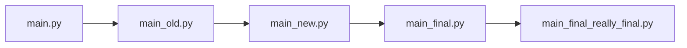

---

<!-- _class: side -->
<!-- Feishu screenshot is landscape: pinned LEFT (mirrored layout), width directive -->

<style scoped>
section.side {
  padding-left: 610px;
}
section.side img {
  right: auto;
  left: 0;
}
</style>


## 02 · Version history that YOU ALREADY KNOW

### THE PANEL YOU NEVER NAMED

Feishu / WPS: open history, restore any autosave, see who changed what.

<br/>

### WORD & POWERPOINT

Autosave plus version history — mistakes become reversible.

<!-- #### YOU KNOW IT -->

---

<!-- Regular content page: landscape image below the text -->

## 03 · Why code needs its own tool

- **A project is a forest** — hundreds of files and folders, not one document
- **Locked to a product** — offline it is gone, no self-hosting
  - *UNNC Living outage: 1000 lines of online edits overwritten*
- **No parallel tries** — no way to keep two versions alive at once
- **Merging** — two people, one file: code auto-merges most of it


*Version control solves the same problem — for code.*

---

<!-- Regular content page: mermaid below the text -->

## 04 · Meet Git (and its ancestor SVN)

- **SVN — centralized** — one server holds the history; offline means stuck
- **Git — distributed** — every clone holds the full history
  - **Born 2005** — Linus Torvalds, built for Linux; today's industry standard

*Centralized vs distributed — the full table in Session 2.*

<div class="columns">
<div class="column">


</div>
<div class="column">


</div>
</div>

---

<!-- Regular content page: mermaid below the text -->

## 05 · Two places, one click

- **Working Tree** — the files you are editing - *your desk*
- **Local Repository** — the saved commit history - *the archive*
- **Demo** — edit `main.py` · type a message · Commit — a new commit exists


*Saving a file is not recording history. Committing is.*

---

<!-- _class: side -->


## 06 · The hidden third place

### THE NEED

Bug fix, new feature, README tweak — commit only the fix.

<br/>

### THE ANSWER

Stage (+) picks what the next commit contains. Your one-click commit was staging everything silently.

---

<!-- Regular content page: mermaid below the text -->

## 07 · Edit, stage, commit

- **Edit** — change files in the editor
- **Stage (+)** — pick what goes into the next commit
- **Commit (check)** — write history with a message
- *Fine-grained: stage single hunks in the diff view*


**A commit is chosen, not dumped.**

---

<!-- Regular content page: landscape placeholder below the text -->

## 08 · Keep some files out of history

- **`.gitignore`** — the list of files Git should pretend not to see - *caches · builds · secrets*
- **`.git`** — the hidden folder where the whole history lives - *never edit it, never commit it*
- *In VS Code: create `.gitignore` in the repo root — those files vanish from Changes*


---

<!-- Regular content page: mermaid below the text -->

## 09 · What a commit really is

- **Not** a log of every keystroke
- **A snapshot** — the whole project at that moment
- **Plus a note** — who, when, what and why

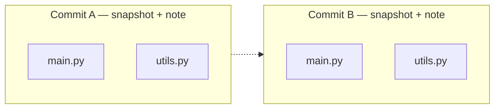

---

<!-- Regular content page: mermaid below the text -->

## 10 · The commit ID is a fingerprint

- **Same content, same ID** — identical in every clone
- **One character changed, whole ID changes** — tamper-evident
- **No way back from ID to content** — a fingerprint, not a zip

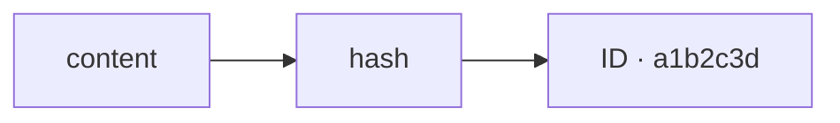

*Hash underneath: SHA-1, or SHA-256 on newer repos — names only.*

---

<!-- Regular content page: mermaid below the text -->

## 11 · History is a line

- Every commit remembers its **previous** one
- The line only grows — nothing in the middle is ever edited

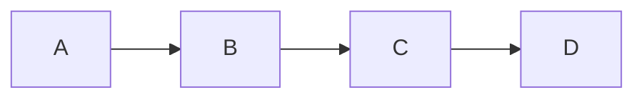

*So when does the line fork? After the break.*

---

<!-- Regular content page: mermaid below the text -->

## 12 · A Branch -> a movable bookmark

- A branch is **not a copy** of the project — it is a bookmark on a commit
- Creating and moving it costs almost nothing


---

<!-- Regular content page: mermaid below the text -->

## 13 · HEAD: where you stand

- **HEAD** — the bookmark you are currently standing on
- It decides where your next commit lands


---

<!-- _class: yellow -->
<!-- Section divider: hands-on -->

## HANDS-ON

### 02

#### Your First Commit

Everyone leaves this room with one commit on their machine

---

<!-- _class: activities -->
<!-- Hands-on steps: four groups -->

## 14 · Fifteen minutes, four steps

<div class="columns">
<div class="column">

### 1 · SIGN IN

- Account icon (bottom-left)
- Sign in with GitHub
- Authorize in the browser.

### 2 · INIT

- New folder `git-practice`
- Open in VS Code, go `Source Control`
- Click `Initialize Repository`

</div>
<div class="column">

### 3 · COMMIT

- Create `main.py`
- Stage ALL + `Initial commit` + Commit
- Find your commit in the graph.

<br/>

### 4 · FEEL THE STAGE

Two files & two commits.
You choose what each one contains.

</div>
</div>

*No Git yet? Click Download Git in the prompt and follow it.*

---

<!-- Regular content page -->

## 15 · Before the break

- Why are **stage** and **commit** two separate steps?
- What does a commit store — keystrokes, or a snapshot?
- What are a **branch** and **HEAD**?

*Stuck? Raise a hand, or open an issue in the repo.*

---

<!-- _class: yellow -->
<!-- Break divider -->

## BREAK

### 10

#### MINUTES

Back soon — Session 2 forks from here

---

<!-- _class: yellow -->
<!-- Section divider: Session 2 -->

## SESSION 2

### 03

#### From Branches to Distributed Collaboration

Branches · merging · conflicts · GitHub

---

<!-- _class: side -->


## 16 · When history forks

### SEVERAL LINES AT ONCE

Keep one line stable, try ideas on another.

### SEPARATE & MERGE

History stops being a line and becomes a graph — a family tree, a river delta.

#### GRAPH

---

<!-- Regular content page: mermaid below the text -->

## 17 · Branch: try safely, switch fast

- **Try safely** — new algorithm on the side, the stable line untouched
- **Nothing is copied** — a branch is just another bookmark
- **How?** — Source Control → click the branch name (top-right) → Create Branch
<br/>


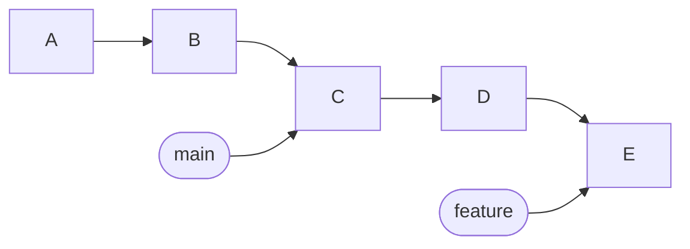

---

<!-- Regular content page: mermaid below the text -->

## 18 · Merge A: fast-forward

- Your line never moved — Git just **slides the bookmark forward**
- No new commit is created


---

<!-- Regular content page: mermaid below the text -->

## 19 · Merge B: three-way

- Both lines moved — Git compares **base, yours, theirs**
- The result is one new **merge commit** with two parents

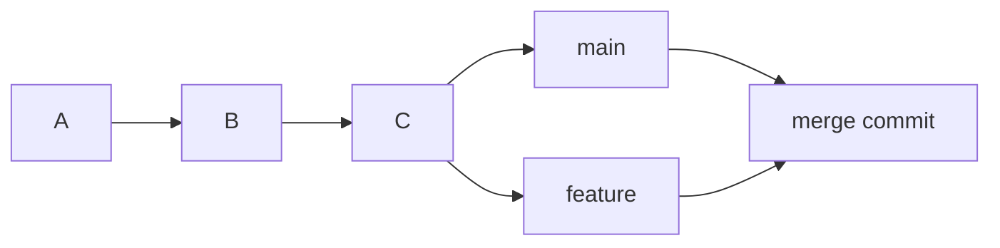

---

<!-- _class: side -->


## 20 · Conflicts are not errors

### SAME LINES, DIFFERENT WISHES

Git refuses to guess which version you meant.

### YOU DECIDE

Resolve, stage, commit — history moves on.

#### RESOLVE

---

<!-- Regular content page: landscape placeholder below the text -->

## 21 · Two small undos

- **Discard (undo arrow)** — drop changes you never staged
- **Unstage (minus)** — take things out of the next commit


*Both live on the file rows in Source Control — hover to see them.*

---

<!-- Regular content page: mermaid below the text -->

## 22 · Undo Last Commit

- Source Control **`···`** → Commit → **Undo Last Commit**
- The commit unwraps: history goes back one step, the **changes wait in Staged Changes**

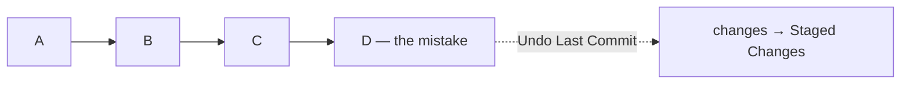

*Unwrapping a commit loses nothing. Pushed already? Fix forward — rewriting shared history needs force push.*

---

<!-- Regular content page with table + mermaid -->

## 23 · Git is not GitHub

| Git | GitHub |
| --- | --- |
| A version control system | A hosting platform for Git repos |
| Runs locally, works offline | Stores remotes, enables sharing |
| Your history lives with you | The meeting place for histories |

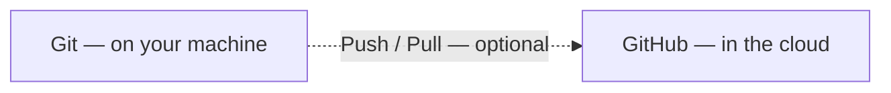

- *Committing needs no internet*

---

<!-- Regular content page with table -->

## 24 · Distributed: Git vs SVN

| | SVN | Git |
| --- | --- | --- |
| History lives | one central server | in every clone |
| Commit offline | no | yes |
| Server down | work stops | everyone still commits |

- *SVN era: leave the office network, stop working. Git era: commit on a plane.*

---

<!-- Regular content page: mermaid below the text -->

## 25 · Remote: who do I sync with?

- A **remote** is a named link to another repository
- `origin` is just the default name — nothing magical
- **In VS Code** — cloning already wired `origin` for you

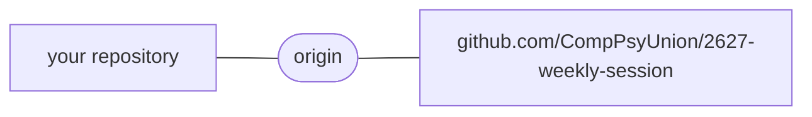

---

<!-- _class: side -->


## 26 · Push: publish your commits

### THE QUESTION

I finished commits locally — how do others see them?

<br/>

### THE ENTRIES

Status Bar → Publish Branch · Source Control **`···`** → Pull, Push → Push.

---

<!-- Regular content page: mermaid below the text -->

## 27 · Fetch: look, don't merge

- Downloads the remote's new commits and moves **origin/main**
- Your own **main** stays exactly where it was

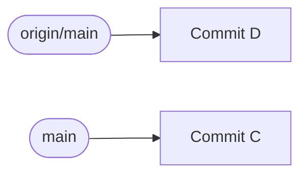

---

<!-- Regular content page: mermaid below the text -->

## 28 · Pull: fetch and integrate

- Fetch first, then integrate: fast-forward, or a merge
- Your line and the remote line meet again

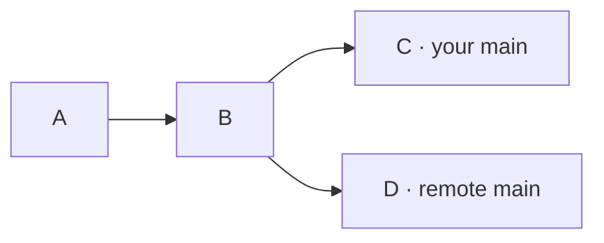

---

<!-- Regular content page: mermaid below the text -->

## 29 · Stash: clear the desk

- Remote box arrives, but unpacked clothes sit on yours — **Pull refuses to stack**
- **Stash** the clothes, **Pull** the box, **Pop** the clothes back

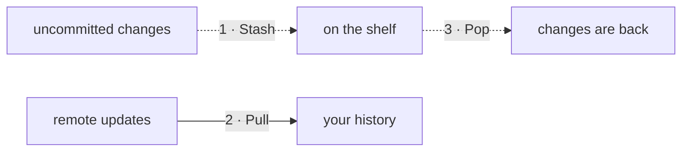

*Source Control ··· → Stash → Stash / Pop Latest Stash.*

---

<!-- Regular content page: mermaid is the whole point -->

## 30 · The whole picture

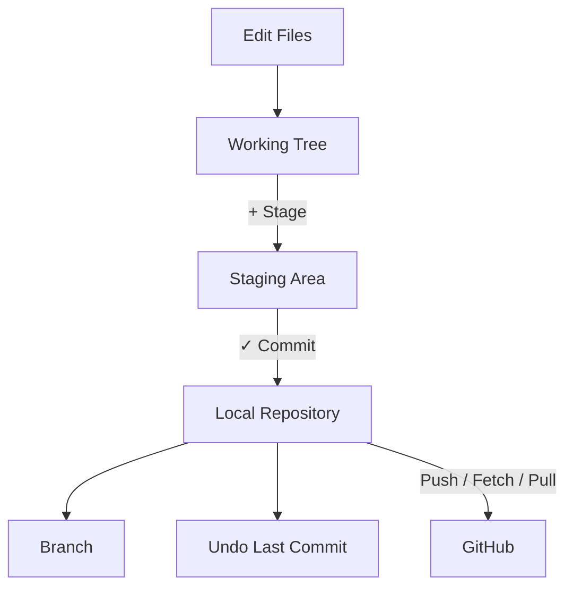

- *Everything from today lives somewhere on this map.*

---

<!-- _class: activities -->
<!-- Final exercise: clone / fork / push — mirrors Session-2 Part 7 -->

## 31 · Clone this repo, push to yours

<div class="columns">
<div class="column">

### 1 · CLONE

Command Palette — `Ctrl+Shift+P` (Win) / `Cmd+Shift+P` (Mac) →

"Git: Clone" → paste the repo URL.

<br/>

### 2 · COMMIT

Make a small change → stage → commit.

</div>
<div class="column">

### 3 · PUSH

Click "Sync Changes" → no write permission? → **Create Fork**.

<br/>
<br/>

### 4 · CHECK

Visit `github.com/<your-username>` — your commit is there.

</div>
</div>

*The whole course, one loop: clone → commit → fork → push.*

---

<!-- _class: todo -->
<!-- Appendix: force push setting, referenced from the talk -->

## APPENDIX

### ALLOW FORCE PUSH

Settings → search `force push` → enable Git: Allow Force Push.

### STAY SAFE

Keep Use Force Push With Lease on — it refuses to overwrite unseen commits.

- Full course notes — `Session-1/` and `Session-2/` in this folder

<br/>
<br/>
<br/>

---

<!-- _class: yellow -->
<!-- Closing page -->

## THANK YOU

### Q&A

#### Start Your History Today

Siyuan He (Robert) · Computer Psycho Union · 30 October 2026
