<style>
/* deck preference: side-pinned images vertically centred and never capped */
section.side img {
  top: 50%;
  transform: translateY(-50%);
  max-width: none;
  max-height: none;
}
</style>

<script src="https://cdn.jsdelivr.net/npm/mermaid@11/dist/mermaid.min.js"></script>
<script>
mermaid.initialize({
  startOnLoad: false,
  theme: 'base',
  themeVariables: {
    fontFamily: "'Noto Sans SC','PingFang SC','Hiragino Sans',sans-serif",
    fontSize: '24px',
    primaryColor: '#fdfaf0',
    primaryBorderColor: '#111111',
    primaryTextColor: '#111111',
    secondaryColor: '#f9dd74',
    secondaryBorderColor: '#111111',
    secondaryTextColor: '#111111',
    tertiaryColor: '#fdf6dd',
    tertiaryBorderColor: '#e3d5a8',
    tertiaryTextColor: '#111111',
    lineColor: '#111111',
    textColor: '#111111',
    edgeLabelBackground: '#f9dd74',
    clusterBkg: '#fdf6dd',
    clusterBorder: '#e3d5a8',
    actorBkg: '#fdfaf0',
    actorBorder: '#111111',
    actorTextColor: '#111111',
    actorLineColor: '#a3a3a3',
    signalColor: '#111111',
    signalTextColor: '#111111',
    noteBkgColor: '#f9dd74',
    noteBorderColor: '#111111',
    activationBkgColor: '#f9dd74',
    activationBorderColor: '#111111',
    sequenceNumberColor: '#111111',
    taskBkgColor: '#f9dd74',
    taskBorderColor: '#111111',
    taskTextColor: '#111111',
    todayLineColor: '#111111',
    gridColor: '#a3a3a3'
  }
});
const renderMermaid = () => {
  document.querySelectorAll('pre.mermaid, pre > code.language-mermaid').forEach((el) => {
    const pre = el.tagName === 'PRE' ? el : el.parentElement;
    const container = document.createElement('div');
    container.className = 'mermaid';
    container.textContent = pre.textContent.trim();
    pre.replaceWith(container);
  });
  mermaid.run();
};
if (document.readyState === 'loading') {
  document.addEventListener('DOMContentLoaded', renderMermaid);
} else {
  renderMermaid();
}
</script>

<!-- _class: lead -->

# Git Under the Hood

## From Version Control to Distributed Collaboration

Siyuan He (Robert)

Computer Psycho Union · 30 October 2026

### WEEKLY 02

#### CPU 2026/27

---

<!-- _class: agenda -->

## What we will cover

1. Version history you already know *- Feishu · Word · WPS*
2. Stage and commit in VS Code *- user-friendly GUI*
3. What a commit really is *- snapshots and fingerprints*
4. Branches and merging *- when history forks*
5. Git and GitHub *- push · fetch · pull · stash*

---

<!-- _class: yellow -->

## SESSION 1

### 01

#### From Saving Files to Building History

Why Git exists · how a commit is born · your first commit

---

<!--
假设你正在开发一个 Python 项目。

第一天，你写出了一个可以运行的版本。

第二天，你增加了一个功能。

第三天，你修改了一个算法，但程序开始出现 Bug。

你会怎么做？

可以先展示几种常见方案：

```text
project/
├── main.py
├── main_old.py
├── main_new.py
├── main_final.py
├── main_final_v2.py
└── main_final_really_final.py
```

这很有趣，但也揭示了几个实际问题：

- **History：** 我们为什么修改了这段代码？
- **Recovery：** 怎样回到某个确定的历史版本？
- **Comparison：** 两个版本究竟有什么区别？
- **Identity：** 哪个文件才是当前真正使用的版本？
- **Experimentation：** 我想尝试一种新算法，但又不想破坏现有版本，怎么办？

接下来可以展示另一种常见做法：把整个项目复制成多个文件夹。

```text
project_backup_1/
project_backup_2/
project_backup_before_refactor/
project_backup_after_refactor/
```

虽然这样比复制单个文件更可靠，但仍然存在很多问题：

- 不容易知道哪些文件发生了变化。
- 不容易准确追踪每一次修改。
- 不容易比较两个版本之间的差异。
- 随着项目规模扩大，备份会越来越笨重。
- 不同版本之间的关系并不清晰。
-->

## 01 · The old-school way

- **Save-as forever** — every "final" version is a new file
- **Copy the folder** — `project_backup_before_refactor/`
- **Which one is real? What changed? How do I go back?**

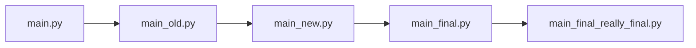

---

<!-- _class: side -->

<style scoped>
section.side {
  padding-left: 610px;
}
section.side img {
  right: auto;
  left: 0;
}
</style>


<!--
> 飞书文档、金山文档、Word 里那个“历史版本”功能，你用过吗？

你大概率已经享受过“版本管理”，只是没有意识到：

- 飞书 / 金山文档：右上角“历史版本”里躺着每一次自动保存的快照，改坏了可以一键恢复，还能看到谁在什么时候改了什么。
- Word / PPT：自动保存 + 版本历史；在线协作时还能看到别人的修改痕迹。
- 这些功能的共同点：**改错了不怕，随时能回到之前的样子。**

可以现场收集一两个“被历史版本救过”的真实故事，气氛会很好。

> **“历史版本”记录的就是你中间改了什么东西——Git 要解决的正是同一类问题，只不过对象是代码。**
-->

## 02 · Version history that YOU ALREADY KNOW

### THE PANEL YOU NEVER NAMED

Feishu / WPS: open history, restore any autosave, see who changed what.

<br/>

### WORD & POWERPOINT

Autosave plus version history — mistakes become reversible.

<!-- #### YOU KNOW IT -->

---

<!--
看起来在线文档已经把问题解决了，但把同样的需求放到代码项目上，很快会遇到新情况：

- 代码项目不是一个文件，而是成百上千个文件组成的目录树，文档工具管不住整个文件夹的变化。
- 这些版本功能绑定在特定产品上：离线不可用、没法部署在自己的服务器上、也难和开发工具配合。
- 想同时试验两种方案（比如两个算法各写一版再挑好的），文档工具没有“分支”的概念。
- 多人协作改同一个文件时，代码需要能自动合并大部分修改。
  - UNNC Living 断网 在线改了 1000 行代码被覆盖

所以程序员需要一个**属于代码的、不依赖某个云服务的版本管理工具**——版本控制系统（Version Control System）。
-->

## 03 · Why code needs its own tool

- **A project is a forest** — hundreds of files and folders, not one document
- **Locked to a product** — offline it is gone, no self-hosting
  - *UNNC Living outage: 1000 lines of online edits overwritten*
- **No parallel tries** — no way to keep two versions alive at once
- **Merging** — two people, one file: code auto-merges most of it


*Version control solves the same problem — for code.*

---

<!--
版本控制系统不止一种。早年的 CVS、SVN 是**集中式**的代表：所有历史放在一台中央服务器上，提交必须连着它——那也是“离开公司网络就干不了活”的时代。Git 则是**分布式**的代表：每个仓库自带完整历史，两者的具体对比放在第二节讲 GitHub 时展开。

Git 由 Linus Torvalds 在 2005 年为开发 Linux 内核而创建，如今几乎是代码版本管理的事实标准。

它的目标不只是帮你保存文件，还要让你能够：

- 记录项目的历史状态。
- 追踪变化。
- 定位历史版本。
- 在不同开发方向之间切换。
- 在不同的开发历史之间整合修改。

**在线文档的“历史版本”和 Git 解决的是同一类问题——管理变化和历史；只是代码需要一个更专业、更自由的工具。**
-->

## 04 · Meet Git (and its ancestor SVN)

- **SVN — centralized** — one server holds the history; offline means stuck
- **Git — distributed** — every clone holds the full history
  - **Born 2005** — Linus Torvalds, built for Linux; today's industry standard

*Centralized vs distributed — the full table in Session 2.*

<div class="columns">
<div class="column">


</div>
<div class="column">

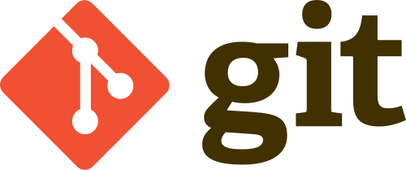

</div>
</div>

---

<!--
从一个动作开始：你修改了 `main.py`，并保存了文件。

此时自然出现第一个需求：**怎么把“现在这个状态”保存成一条以后可以回去的记录？**

回答这个需求，只需要两个区域：

| 区域 | 作用 | 可以怎么理解 |
| --- | --- | --- |
| Working Tree | 当前实际编辑的项目文件 | 你的工作台 |
| Local Repository | 已经保存的提交历史 | 项目的历史档案 |

在 VSCode 中演示“从工作台写入档案柜”，看起来只要一步：

1. 修改 `main.py` 并保存，打开 Source Control view（Activity Bar 中的 Source Control 图标，快捷键 Ctrl+Shift+G）。`main.py` 出现在 `Changes` 列表中——这就是工作区的当前状态（`git status` 回答的问题）。
2. 在视图顶部的消息框输入提交信息（例如 `Add input validation`）。
3. 直接点击 **✓ Commit**。 `Changes` 列表清空；打开提交图，可以看到新出现的提交——工作区的状态被写入了本地仓库。

关键在于：**这两个区域不是同一个东西。**

修改文件并保存，只是改变了 Working Tree；只有点击 **✓ Commit** 创建提交之后，这个状态才进入 Local Repository 的历史。

不过，这个“直接提交”的一步里其实藏着一点细节——先记住这个疑问，下一节从一个新的需求出发揭晓它。
-->

## 05 · Two places, one click

- **Working Tree** — the files you are editing - *your desk*
- **Local Repository** — the saved commit history - *the archive*
- **Demo** — edit `main.py` · type a message · Commit — a new commit exists

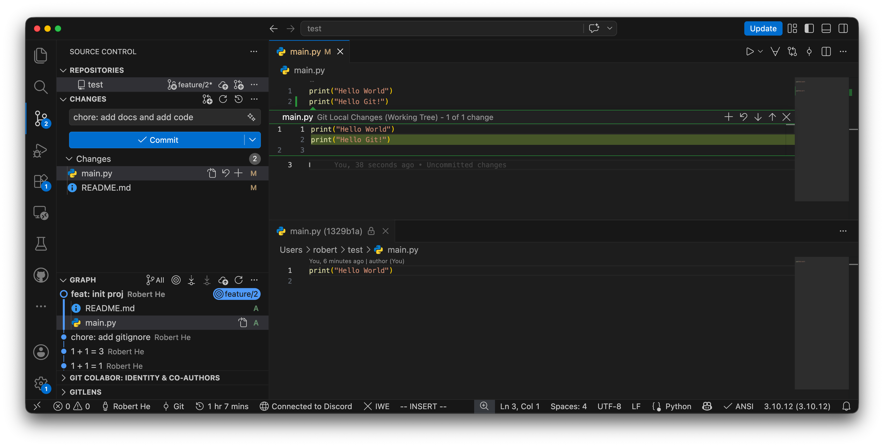

*Saving a file is not recording history. Committing is.*

---

<!-- _class: side -->

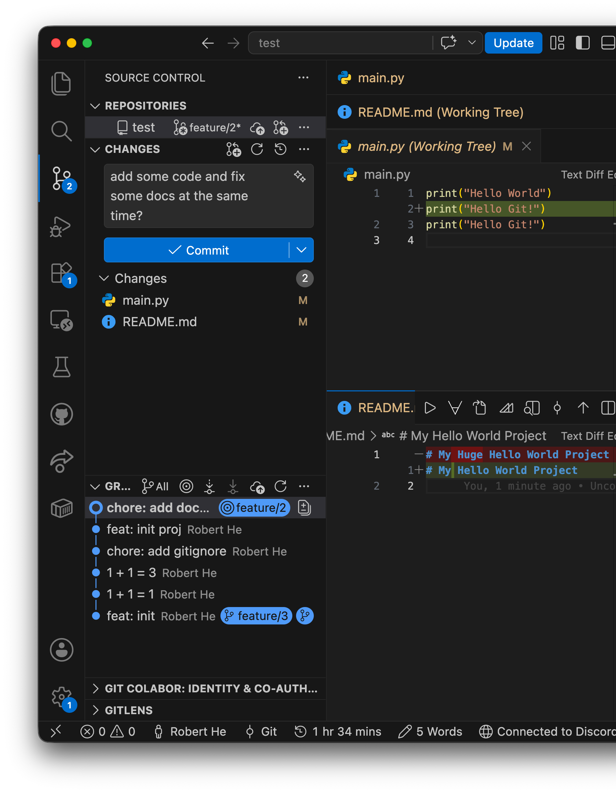

<!--
这里值得多花一点时间。

假设你修改了三个文件：

```text
main.py
parser.py
README.md
```

其中：

- `main.py` 修复了一个 Bug。
- `parser.py` 增加了新功能。
- `README.md` 只修改了格式。

你希望先提交 Bug 修复，而不把另外两个修改放进去。

如果没有中间的挑选环节，你可能需要手动复制文件、撤销部分修改，或者想办法把修改拆开。

这正是第三个区域存在的原因——**Staging Area（暂存区，也叫 Index）**：准备纳入下一次提交的内容，可以理解为**下一份提交的草稿**。它位于工作台和档案柜之间：先挑选要归档的内容放进草稿，再统一写入历史。

回头再看上一节的演示：点击 **✓ Commit** 时， `Changes` 列表里还有未暂存的内容，VSCode 其实替你多做了一步——先把它们放进暂存区（对应 `git add`），再创建提交（对应 `git commit`）。暂存区一直都在，只是被“直接提交”的便利藏在了幕后；当你需要只提交一部分修改时，它才走到台前。

在 VSCode 中，这只意味着：只点击 `main.py` 旁边的 **+**（只暂存这一个文件），然后输入 `Fix input validation`，点击 **✓ Commit** 提交。

注意，这并不是说其他文件的修改已经消失了。它们仍然可以留在工作区，等待后续处理。

如果需要更细粒度的控制，VSCode 也支持部分暂存：点击 `Changes` 列表中的文件打开 diff view，把鼠标悬停在某个变更块（hunk）上点击 **+**，就能做到只暂存某个文件中的某一小块代码，而不是整个文件。

这相当于按块、按范围挑选要进入下一次提交的内容。
-->

## 06 · The hidden third place

### THE NEED

Bug fix, new feature, README tweak — commit only the fix.

<br/>

### THE ANSWER

Stage (+) picks what the next commit contains. Your one-click commit was staging everything silently.

---

<!--
假设 `main.py` 原本是：

```python
print("Hello")
```

你把它改成：

```python
print("Hello, Git")
```

然后在 Source Control view 中点击 `main.py` 旁边的 **+**，完成暂存。

之后，你又把文件改成：

```python
print("Hello, Git!")
```

最后输入提交信息 `Update greeting`，点击 **✓ Commit** 提交。

问题是：提交里会是什么内容？

**答案是：**

```python
print("Hello, Git")
```

因为点击 **+** 的那一刻，当时的文件内容已经进入暂存区，之后的修改不会自动更新暂存区。

这非常适合做一次简短的互动提问。

它能直接帮助学生理解为什么“暂存”和“提交”是两个独立步骤。

```text
Edit → Stage → Commit
```

它们分别对应：

```text
修改文件 → 选择提交内容 → 创建历史记录
```

在 VSCode 中，这三步分别对应：在编辑器中修改文件 → Source Control view 中点击 **+** → 输入提交信息后点击 **✓ Commit**。

建议让学生把这个模型记住，而不是先记住十几个操作。
-->

## 07 · Edit, stage, commit

- **Edit** — change files in the editor
- **Stage (+)** — pick what goes into the next commit
- **Commit (check)** — write history with a message
- *Fine-grained: stage single hunks in the diff view*

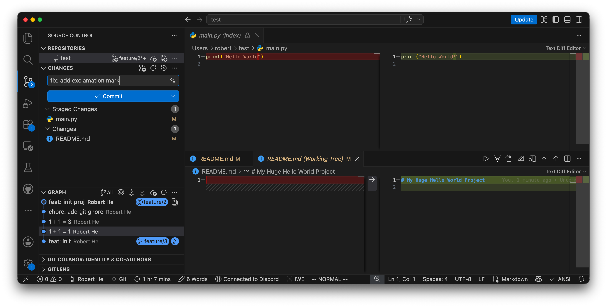

**A commit is chosen, not dumped.**

---

<!--
完成几次提交后，很快会发现两类“不该被记录”的东西：

- **环境杂物**——`.DS_Store`、`__pycache__/`、`node_modules/`、编译产物：每次都变，却没有记录价值，只会把历史撑得又大又乱。
- **不想公开的内容**——带密码的配置文件、API key：一旦提交，就进了历史，删掉当前版本也删不掉过去的记录。

这正是 `.gitignore` 存在的原因：在仓库根目录放一个名为 `.gitignore` 的文本文件，写上“不进历史”的名单，Git 就会假装看不见它们：

```text
.DS_Store
__pycache__/
*.pyc
.env
```

在 VSCode 中：资源管理器中新建文件 `.gitignore`（快捷键新建），写好保存——之后 `Changes` 列表里就不会再出现这些文件。GitHub 创建仓库时也提供现成的忽略模板（Python、Node 等），可以直接选用。

顺带回答一个此阶段必然出现的问题：**历史到底存在哪里？** 就在项目根目录那个隐藏的 `.git` 文件夹里——提交、分支、暂存区全部住在里面。日常不需要打开它，更不要手动修改或把它提交进仓库；把它删掉，历史就消失了（只剩工作区里的文件）。

要判断某个文件夹是否是一个 Git 仓库的重要线索也是看本文件夹下是否有一个 `.git` 目录。如果你想把一个普通文件夹变成一个被 Git 追踪历史的特殊文件夹，只需要在该目录下运行一个 Git 的内置命令 `git init` 或者在 vscode 打开一个文件夹之后在 `Source Control` 面板点击 `Initialize Repository` 按钮即可。
-->

## 08 · Keep some files out of history

- **`.gitignore`** — the list of files Git should pretend not to see - *caches · builds · secrets*
- **`.git`** — the hidden folder where the whole history lives - *never edit it, never commit it*
- *In VS Code: create `.gitignore` in the repo root — those files vanish from Changes*

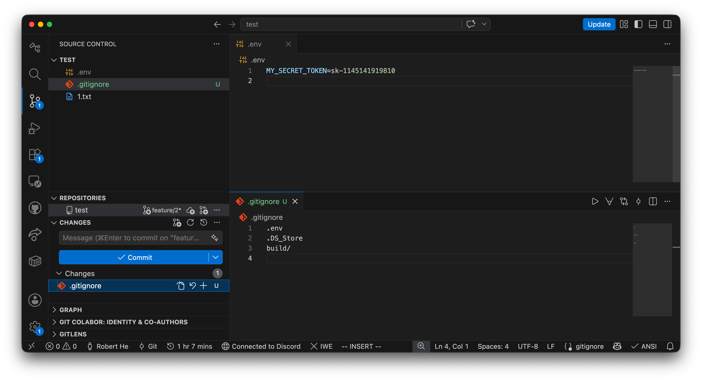

---

<!--
这一部分只回答一个问题，点到为止，不展开内部实现。

先问学生：

> 当你在 VSCode 中点击 **✓ Commit** 创建一次提交时，Git 究竟保存了什么？

很多初学者会认为 Git 主要记录每一次修改的操作，例如：

```text
1. 在第 3 行增加一个函数
2. 删除第 5 行
3. 修改变量名
```

但 Git 的做法更简单直接：**每次提交，保存项目在这一刻的完整状态（一份快照），再附上一条说明。**

一句话概括：

> **一次提交 = 一份项目快照 + 一条“这次谁改了什么、为什么改”的说明。**

例如，Commit A 记录的是：

```text
main.py
utils.py
README.md
```

这三个文件在那一刻的样子。你修改了 `main.py` 后创建 Commit B，它记录的又是新一刻的完整样子。
-->

## 09 · What a commit really is

- **Not** a log of every keystroke
- **A snapshot** — the whole project at that moment
- **Plus a note** — who, when, what and why

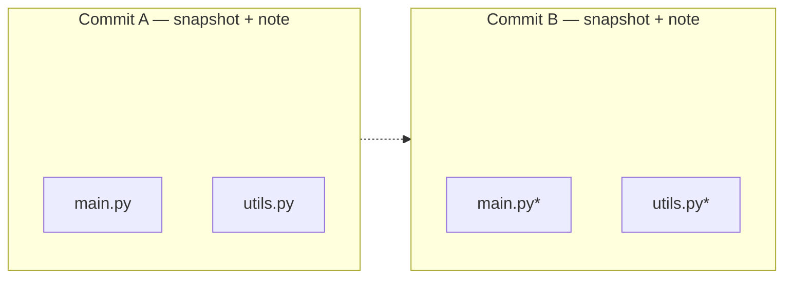

---

<!--
每次提交还会自动附上：作者、时间、你填写的提交说明，以及一个像指纹一样的提交 ID（比如 `a1b2c3d`）。

提交 ID 来自一次**哈希（hash）运算**：把内容交给一个固定的函数，算出一串定长的字符串。记住哈希的三个特性即可：

- **同样的内容，算出的 ID 一定相同。** 所以两处出现同一个 ID，就说明内容完全一致。
- **内容哪怕只改一个字符，ID 也会整个变掉。** 所以 ID 没变，内容就没被悄悄改动过——相当于自带“防篡改封条”。
- **没法从 ID 反推出内容。** 它是内容的“指纹”，不是“压缩包”。

顺带一提：Git 传统上使用 SHA-1（40 位十六进制），新仓库也支持 SHA-256——知道名字即可。

至于快照在磁盘上具体怎么存、相同的文件如何复用，属于 Git 的内部实现，这节课刻意不讲。你只需要记住：

> Git 记录的是“项目每个时刻长什么样”，而不是“你敲过的每一步操作”。
-->

## 10 · The commit ID is a fingerprint

- **Same content, same ID** — identical in every clone
- **One character changed, whole ID changes** — tamper-evident
- **No way back from ID to content** — a fingerprint, not a zip

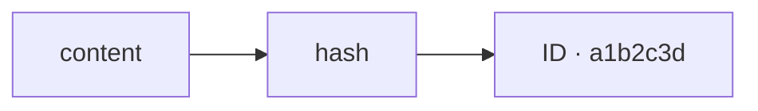

*Hash underneath: SHA-1, or SHA-256 on newer repos — names only.*

---

<!--
每创建一次提交，它都会接在上一次提交的后面，于是项目历史像一条链一样不断向前生长：

```mermaid
graph LR
    A -> B -> C -> D
```

一句话概括：**每个提交都记得自己的“上一个”是哪个提交，所以历史能一路追溯回起点。**

到目前为止，这条线都是直的。它什么时候会“岔开”？岔开之后又怎么合回来？——这是第二节的开场问题，先卖个关子。
-->

## 11 · History is a line

- Every commit remembers its **previous** one
- The line only grows — nothing in the middle is ever edited

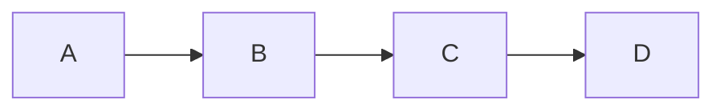

*So when does the line fork? After the break.*

---

<!--
仓库里可以同时存在很多提交，Git 需要一种方式标记“值得指认的那些提交”。答案是引用（reference）：**一张贴在某个提交上、可以随时挪动的“书签”**。

例如：

```mermaid
graph LR
    main(["main"]) -> C
```

`main` 就是这样一个引用，此刻指向提交 C。

当你在 `main` 上创建新提交 D 时，Git 不需要改动任何历史，只要把这个引用移动到 D：

```mermaid
graph LR
    A -> B -> C -> D
    main(["main"]) -> D
```

这也是 Git 中分支非常轻量的原因之一。

分支并不是把整个项目复制一份，而是一个指向提交的可移动引用。

一句话：**分支就是贴在某个提交上的书签，创建和移动它几乎零成本。**
-->

## 12 · A Branch -> a movable bookmark

- A branch is **not a copy** of the project — it is a bookmark on a commit
- Creating and moving it costs almost nothing

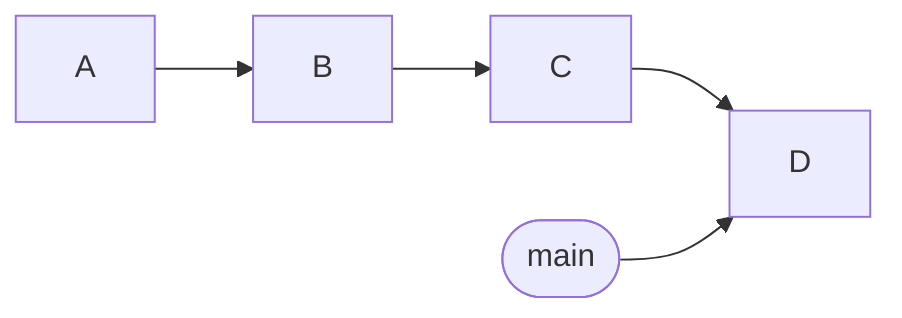

---

<!--
分支和引用都可以有很多个，于是还剩最后一个问题：**你本人现在站在哪个分支上？** 换句话说，下次点击 **✓ Commit** 创建的提交会落到哪个分支？

Git 用一个特殊标记回答：`HEAD` 表示当前检出的版本位置，通常通过当前分支引用间接指向一个提交。

例如：

```mermaid
graph TD
    HEAD(["HEAD"]) -> main(["main"])
    main -> D["Commit D"]
```

如果你切换到另一个分支，`HEAD` 的位置也会随之改变——VSCode Status Bar 左下角显示的分支名，反映的正是 `HEAD` 当前所在的分支。

一句话：**HEAD 就是“你现在站在哪”的标记。**

这里可以只介绍概念，不必深入 detached HEAD 等特殊状态。
-->

## 13 · HEAD: where you stand

- **HEAD** — the bookmark you are currently standing on
- It decides where your next commit lands

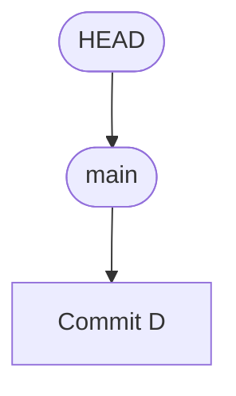

---

<!-- _class: yellow -->

## HANDS-ON

### 02

#### Your First Commit

Everyone leaves this room with one commit on their machine

---

<!-- _class: activities -->

<!--
这一部分留出真正的上机时间，目标只有一个：**每个人现场完成自己的第一次 Commit。**

### 5.0 前置检查：电脑上还没装 Git 怎么办（约 2 分钟）

大部分同学打开 VSCode 后 Source Control view 就能直接用；如果它提示 “Download Git” 或弹出 “Git not found. Would you like to install Git?”，说明系统里还没有 Git。

1. 直接点击提示中的 **Download Git** / **Install** 按钮，按提示一步步装完；macOS 若弹出“需要安装命令行开发者工具”的对话框，点“安装”即可，里面自带 Git。
2. 装完后按提示**重启 VSCode**。
3. 重新打开 Source Control view，不再出现该提示，就说明 Git 已就绪。

### 5.1 准备：在 VSCode 中登录 GitHub（约 3 分钟）

1. 点击 VSCode 左下角的账户头像图标 → “Sign in with GitHub”。
2. 浏览器会打开 GitHub 授权页面，登录并点击 **Authorize visual-studio-code**。
3. 回到 VSCode，账户图标处显示你的 GitHub 用户名/头像，即登录成功。

登录之后，VSCode 可以直接以你的身份发布、克隆仓库——第二节推送时不再需要现场折腾认证。

### 5.2 创建仓库并完成第一次提交（约 5 分钟）

1. 在电脑上你喜欢的位置新建文件夹 `git-practice`，在 VSCode 中打开：文件 → 打开文件夹。
2. 打开 Source Control view，点击“Initialize Repository”按钮。
3. 新建 `main.py`，写一行 `print("hello, git")` 并保存——文件立刻出现在 Source Control view 的 `Changes` 列表里。
4. 消息框输入 `Initial commit`，点击 **✓ Commit**。
5. 打开提交图（**···** → “View Commit Graph”），找到自己刚创建的第一个提交；点击 `Changes` 里的文件还能打开 diff view。

### 5.3 再来一次，体会暂存区（约 1 分钟，时间允许时）

- 修改 `main.py`，再新建一个 `notes.md`。
- 这次先只点 `main.py` 旁的 **+** 暂存并提交，再单独暂存提交 `notes.md`。
- 提交图里出现两次提交——这就是“自己挑选下一次提交包含什么”。
-->

## 14 · Fifteen minutes, four steps

<div class="columns">
<div class="column">

### 1 · SIGN IN

- Account icon (bottom-left)
- Sign in with GitHub
- Authorize in the browser.

### 2 · INIT

- New folder `git-practice`
- Open in VS Code, go `Source Control`
- Click `Initialize Repository`

</div>
<div class="column">

### 3 · COMMIT

- Create `main.py`
- Stage all + `Initial commit` + Commit
- Find your commit in the graph.

<br/>

### 4 · FEEL THE STAGE

Two files & two commits.
You choose what each one contains.

</div>
</div>

*No Git yet? Click Download Git in the prompt and follow it.*

---

<!--
### Session 1 核心结论

- 一次提交 = 项目快照 + 一条“改了什么”的说明。
- 提交连成历史，分支是书签，HEAD 标记你现在的位置。

记住这三句话，第二节的一切都会顺理成章。

### 5.4 下课前三个问题

1. 为什么“暂存”和“提交”是两个不同的步骤？
2. 一次提交里保存的是什么——是你的每一步操作，还是项目那一刻的样子？
3. 分支和 HEAD 分别是什么？

最后用一句话收束：

> Git records snapshots, connects them into history, and gives us ways to navigate that history.

走动帮同学排障，常见问题：没装 Git（按 5.0 点提示按钮装好并重启）、GitHub 没登录成功、文件夹没有在 VSCode 中打开、误把整个主目录初始化成仓库。没跟上的同学可以课后照着 5.0–5.2 补齐，或到仓库 issue 提问。
-->

## 15 · Before the break

- Why are **stage** and **commit** two separate steps?
- What does a commit store — keystrokes, or a snapshot?
- What are a **branch** and **HEAD**?

*Stuck? Raise a hand, or open an issue in the repo.*

---

<!-- _class: yellow -->

## BREAK

### 10

#### MINUTES

Back soon — Session 2 forks from here

---

<!-- _class: yellow -->

## SESSION 2

### 03

#### From Branches to Distributed Collaboration

Branches · merging · conflicts · GitHub

---

<!-- _class: side -->

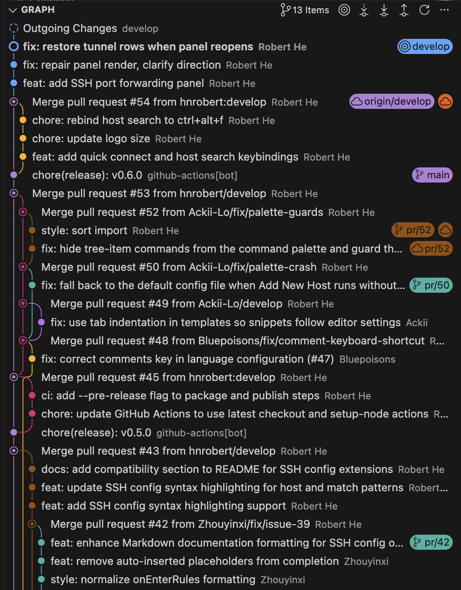

<!--
第一节里，我们看到的提交历史都是一条直线：新提交接在旧提交后面，一路向前。

但真实的开发常常需要**几条线同时推进**：一条保持稳定可用，另一条拿去做试验。一旦几条线从同一个版本出发各自延伸、之后又汇合，历史就不再是一条线，而是一张会**分叉和汇合的图（Graph）**——像家谱，也像河流的分叉与合流：

```mermaid
graph LR
    A -> B -> C
    C -> D -> E
    C -> F -> G
    E -> M["M"]
    G -> M
```

第二节的所有主角——分支、合并、冲突、撤销——都是在这张图上发生的故事。先从“为什么需要岔出一条线”讲起。
-->

## 16 · When history forks

### SEVERAL LINES AT ONCE

Keep one line stable, try ideas on another.

### SEPARATE & MERGE

History stops being a line and becomes a graph — a family tree, a river delta.

#### GRAPH

---

<!--
假设项目历史如下：

```mermaid
graph LR
    A -> B -> C
```

现在你想增加一个新功能。

一种方法是在当前版本上直接修改：

```mermaid
graph LR
    A -> B -> C -> D
```

但如果你不确定这个功能能否成功，就会面临一个问题：

**如何在保留现有稳定版本的同时，安全地尝试新方案？**

如果每次尝试都复制整个项目，会出现之前讨论过的问题。

Git 的分支允许你在现有历史基础上创建另一条开发路径。

### 1.2 Branch 是什么？

满足这个需求的方案，就是在现有历史基础上分出一条可以独立推进的开发路径。例如：

```mermaid
graph LR
    A -> B -> C
    C -> D -> E
    main(["main"]) -> C
    feature(["feature"]) -> E
```

这个图表示：

- `main` 仍然指向 C。
- `feature` 指向 E。
- 两个分支共享之前的历史，但后续提交可以不同。

历史在这里第一次“岔开”——正是前奏里那张图的最小版本：一条线停在 C，另一条继续走到 E。

分支的重点是：**允许不同的开发路径独立推进，而不必复制整个仓库。**

### 1.3 在 VSCode 中创建和切换分支

在 VSCode 中，分支操作集中在**Status Bar 左下角的当前分支名**上：

- 点击分支名，在弹出的下拉列表中选择已有分支，即可切换到该分支。
- 选择“Create New Branch...”，输入 `feature` 并回车，一步完成“创建 + 切换”。

这里可以解释一个容易被误解的地方：

**创建分支本身不会创建一个新的提交，也不会立即复制一份项目。**

它主要是在 Git 中创建一个新的分支引用。

可以把这看作一个非常轻量的操作。
-->

## 17 · Branch: try safely, switch fast

- **Try safely** — new algorithm on the side, the stable line untouched
- **Nothing is copied** — a branch is just another bookmark
- **How?** — Source Control → click the branch name (top-right) → Create Branch
<br/>

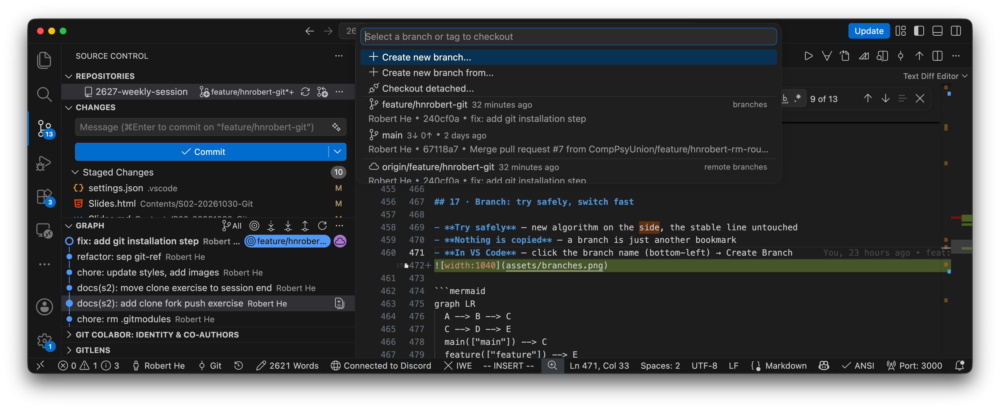


---

<!--
分支解决了独立开发的问题，但当功能开发完成后，我们往往需要把修改整合起来。

这就引出了 merge。

### 2.1 一个简单的合并场景

假设：

```mermaid
graph LR
    A -> B -> C -> D
    C -> E -> F
    main(["main"]) -> D
    feature(["feature"]) -> F
```

其中：

- `main` 指向 D。
- `feature` 指向 F。
- C 是两个分支的共同祖先。

现在你希望把 `feature` 的开发成果合并到 `main`。

Git 会根据提交历史和文件内容来判断如何完成整合。

### 2.2 Fast-forward 与三方合并

可以介绍两种常见情况。

**情况 A：Fast-forward**

假设 `main` 仍然指向 C，而 `feature` 已经前进到 E：

```mermaid
graph LR
    A -> B -> C -> D -> E
    main(["main"]) -> C
    feature(["feature"]) -> E
```

当切换到 `main` 并合并 `feature` 时，如果 `main` 没有独立的新提交，Git 可以直接把 `main` 引用移动到 E。

这就是 fast-forward。

它不需要创建新的合并提交。
-->

## 18 · Merge A: fast-forward

- Your line never moved — Git just **slides the bookmark forward**
- No new commit is created


---

<!--
**情况 B：Three-way merge**

如果 `main` 和 `feature` 都产生了独立提交：

```mermaid
graph LR
    A -> B -> C
    C -> D["D（main）"]
    C -> E["E（feature）"]
    D -> M["M（merge commit）"]
    E -> M
```

Git 可以使用三个版本进行合并：

1. 共同祖先 C。
2. `main` 上的版本 D。
3. `feature` 上的版本 E。

这就是三方合并的基本思路。

Git 不只是把两个文件直接拼在一起，而是利用共同祖先和两个分支的变化来尝试整合修改。
-->

## 19 · Merge B: three-way

- Both lines moved — Git compares **base, yours, theirs**
- The result is one new **merge commit** with two parents

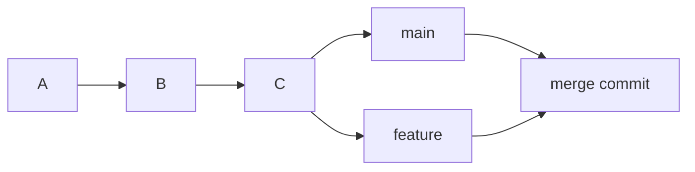

---

<!-- _class: side -->

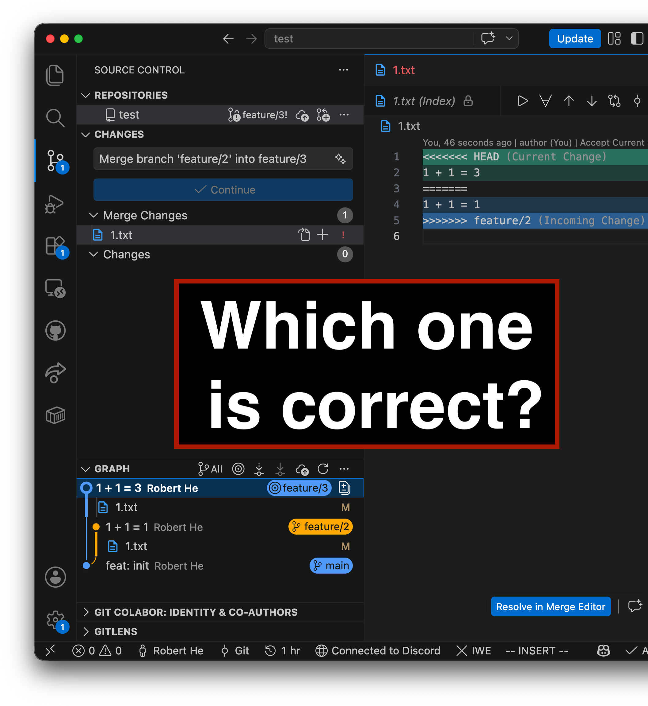

<!--
现在假设两个分支都修改了同一个函数：

```python
def calculate_price(price):
    return price * 1.0
```

`main` 修改为：

```python
def calculate_price(price):
    return price * 1.1
```

`feature` 修改为：

```python
def calculate_price(price):
    return price * 1.2
```

Git 无法确定开发者究竟希望采用哪一种业务逻辑。

因此，它可能产生冲突，需要开发者决定最终结果。

关键点是：

**冲突不一定意味着 Git 失效，而可能意味着 Git 缺乏足够的信息来判断开发者的真实意图。**

Git 可以处理大量结构清晰、没有歧义的修改；但它无法仅凭代码差异理解所有业务语义。

### 2.4 冲突是否只会发生在同一行？

不一定。

同一行的不同修改很容易产生冲突，但不同位置的修改也可能发生冲突。

例如：

- 一方删除了某个函数，另一方修改了这个函数。
- 一方重命名文件，另一方修改了旧文件。

这里可以把冲突理解为：**自动整合无法可靠地确定最终结果，需要人为介入。**
-->

## 20 · Conflicts are not errors

### SAME LINES, DIFFERENT WISHES

Git refuses to guess which version you meant.

<br/>

### YOU DECIDE

Resolve, stage, commit - history moves on.

#### RESOLVE

---

<!--
这一部分很适合用来解释 Git 的历史模型有什么实际价值。

学生可能会问：

> 如果我提交了一次错误修改，能不能撤销？

答案是可以，但不同的撤销操作针对的是不同层次。

### 5.1 先区分三个问题

| 问题 | VSCode 中的操作 |
| --- | --- |
| 我修改了文件，但还没有暂存，想丢弃这些修改 | Source Control view 中悬停该文件 → 点击 **↩**（Discard Changes） |
| 我已经暂存了修改，但还没有提交，想取消暂存 | 在“Staged Changes”中点击 **−**（Unstage Changes） |
| 我刚提交了一次错误修改，想把这次提交收回来 | Source Control view **···** → Commit → **Undo Last Commit** |
-->

## 21 · Two small undos

- **Discard (undo arrow)** — drop changes you never staged
- **Unstage (minus)** — take things out of the next commit

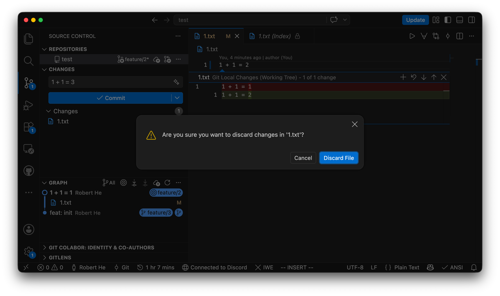

*Both live on the file rows in Source Control — hover to see them.*

---

<!--
对于最后一种情况，VSCode 内置的 **Undo Last Commit** 最适合初学者：它把最近一次提交原样“退回”——提交从历史里消失，改动回到 “Staged Changes” 列表，可以修改后重新提交。

例如，D 是一次错误提交：

```mermaid
graph LR
    A -> B -> C -> D["D（错误提交）"]
```

执行 **Undo Last Commit** 后，D 从历史中收回，历史回到 C；D 的改动完好地待在 “Staged Changes” 里等你处理：

```mermaid
graph LR
    A -> B -> C
```

一句话：**撤销提交不等于丢改动——只是把“提交”这层包装退掉，内容回到暂存区。**

需要提醒边界：Undo Last Commit 只收回**最近一次**提交，最适合还没有 push 的场景。已经 push 的提交技术上也能收回——但改写完再推送需要 **force push**（带 `--force` 的推送），会打乱基于旧历史协作的人，初学阶段不推荐；用一次新的提交去修正错误更稳妥。

### 5.2 那更早的、已经推送的提交呢？

可以简单提及，不必展开操作细节。

- 更早的错误提交：用**新的提交**把改错的内容改回来，不改写历史。
- 背后更精细的工具（revert、reset 等）这节课不展开，以后需要时再学。

> 一条够用的规则：**没推送的提交可以随意收回；已推送的提交也能改，但再次推送要加 `--force`（force push），会影响他人协作——不推荐。**（VS Code 里如何开启 force push，见文末附录。）
-->

## 22 · Undo Last Commit

- Source Control **`···`** → Commit → **Undo Last Commit**
- The commit unwraps: history goes back one step, the **changes wait in Staged Changes**

```mermaid
graph LR
  A --> B --> C --> D["D — the mistake"]
  D -.->|"Undo Last Commit"| S["changes → Staged Changes"]
```

<br/>

*Unwrapping a commit loses nothing.*
*Pushed already? Fix forward — rewriting shared history needs force push.*

---

<!--
这一部分是从本地 Git 过渡到 GitHub 的关键。

先提出一个问题：

> 如果 Git 已经能在本地保存历史，为什么还需要 GitHub？

### 3.1 Git 和 GitHub 不是同一个东西

可以先给出一个简单对比：

| Git | GitHub |
| --- | --- |
| 一个版本控制系统 | 一个提供 Git 仓库托管等服务的平台 |
| 可以在本地运行 | 可以托管远程仓库 |
| 可以记录提交、管理分支、整合历史 | 可以保存远程仓库，便于跨设备或多人共享 |
| 不要求必须使用 GitHub | 可以托管 Git 仓库，但不等于 Git 本身 |

例如，你完全可以在没有网络的情况下，只用 VSCode 完成：

1. 打开 Source Control view，点击“Initialize Repository”按钮，在当前文件夹创建仓库。
2. 在 Source Control view 点击“Changes”标题栏的 **+**（Stage All Changes）。
3. 输入提交信息 `Initial commit`，点击 **✓ Commit** 提交。

这些操作不需要 GitHub。

因此，GitHub 不是 Git 的必要组成部分。
-->

## 23 · Git is not GitHub

| Git | GitHub |
| --- | --- |
| A version control system | A hosting platform for Git repos |
| Runs locally, works offline | Stores remotes, enables sharing |
| Your history lives with you | The meeting place for histories |

```mermaid
graph LR
  L["Git — on your PC"]
  GH["GitHub — cloud"]
  L -.->|"Push / Pull"| GH
```

- *Committing needs no internet*

---

<!--
看一个具体场景。假设有两名开发者：

```mermaid
graph TD
    A["Developer A<br>Local Repository"]
    GH["GitHub"]
    B["Developer B<br>Local Repository"]
    A <-> GH
    GH <-> B
```

A 和 B 都可以在本地创建提交、查看历史、切换分支——哪怕此刻完全没有网络。

为什么做得到？关键区别是：**每个正常克隆得到的仓库都自带完整的提交历史，而不只是文件的一份副本。** 他们各自手里都有一个功能完整的仓库。

这也正好回答了第一节埋下的问题：Git 和更早的 SVN 有什么区别？

| | SVN（集中式） | Git（分布式） |
| --- | --- | --- |
| 历史存在哪里 | 只在中央服务器 | 每个克隆都有完整历史 |
| 提交需要联网吗 | 必须连着中央服务器 | 不需要，本地随时提交 |
| 中央服务器宕机 | 所有人无法提交、无法协作 | 每人手里仍有完整仓库，之后随便挑一份同步 |
| 典型协作方式 | 围绕中央仓库转 | 任意仓库互相同步，GitHub 是最流行的“汇合点” |

一句话：**SVN 的提交和历史都在中央服务器上——连不上它（服务器挂了，或者你人在飞机上），就提交不了、也查不了历史；Git 的完整历史就在你手里——飞机上照样提交。**（较真备注一：SVN 离线时编辑文件、对比改动、恢复单个文件仍然可行，这些只依赖本地工作副本；离不开服务器的是 commit、update、log、branch 等关键操作。较真备注二：浅克隆等特殊配置下 Git 本地不一定有全部历史，这里按普通完整克隆讨论。）
-->

## 24 · Distributed: Git vs SVN

| | SVN | Git |
| --- | --- | --- |
| History lives | one central server | in every clone |
| Commit offline | no | yes |
| Server unreachable | no commits, no history | everyone still commits |

- *SVN: edits and diffs still work offline — committing and history need the server.*
- *Git: the whole history is on your laptop — commit on a plane.*

---

<!--
本地有了完整历史之后，新需求出现了：把提交发布到 GitHub，或者拿到别人的更新。这要求本地仓库先记住“要打交道的远程仓库是谁、地址是什么、给它叫什么名字”。

这就是 remote：一条命名的远程仓库连接配置。

这些都会在结课练习（Part 7）里亲眼看到：clone 时 Git 自动把来源仓库配置为名为 `origin` 的 remote；选择 fork 推送时，VS Code 又自动把你自己 GitHub 账号下的仓库关联了进来——全程没有一步手动的“配置远程”操作。

这里要强调：

**`origin` 只是一个常见的默认名称，不是 GitHub 的特殊关键字。**

一个 remote 可以关联到 GitHub，也可以关联到公司内部的 Git 服务器，甚至是另一台电脑上的仓库。
-->

## 25 · Remote: who do I sync with?

- A **remote** is a named link to another repository
- `origin` is just the default name — nothing magical
- **In VS Code** — cloning already wired `origin` for you

```mermaid
graph LR
  R["your repository"]
  O1(["upstream"])
  O2(["origin"])
  GH1["github/CPU/repo"]
  GH2["github/YOU/repo"]
  R --- O1
  R --- O2
  O1 --- GH1
  O2 --- GH2
```

---

<!-- _class: side -->

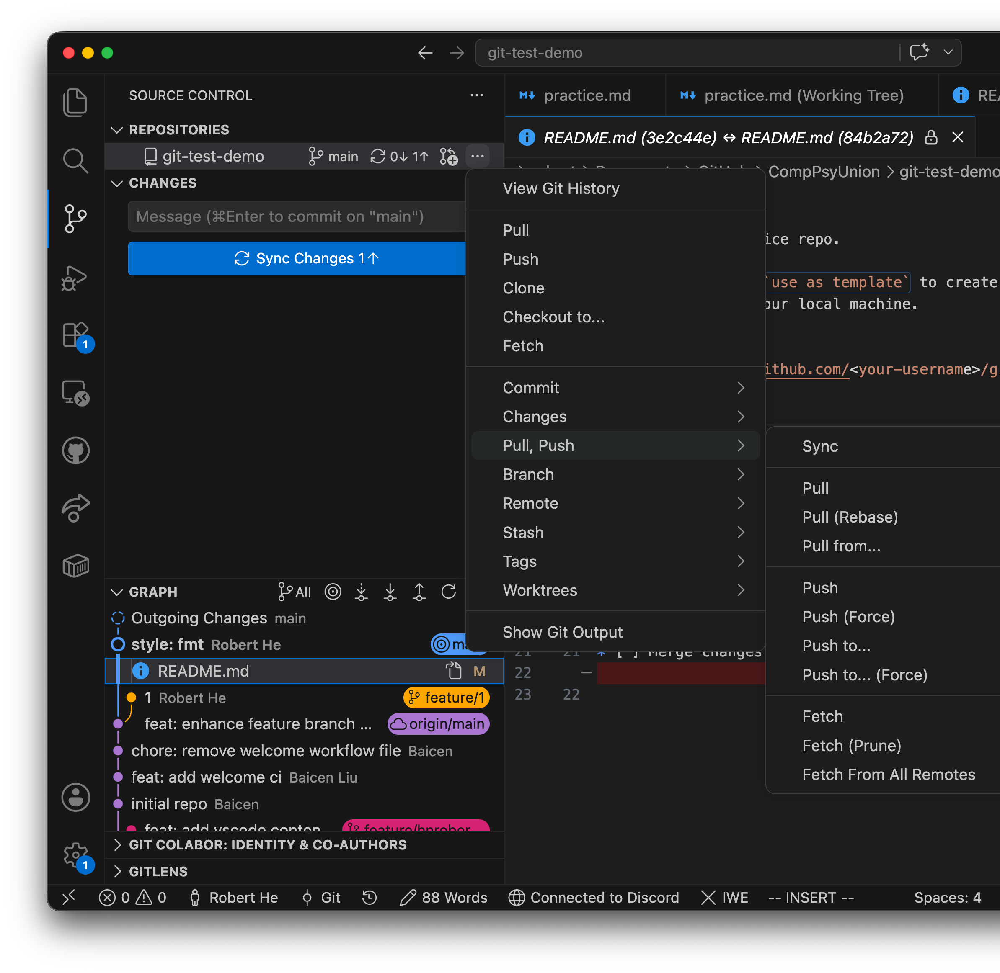

<!--
我建议把它讲成三个先后出现的问题，而不是让学生死记操作：

1. 我在本地完成了提交，怎么发布出去？（push）
2. 远程有没有别人的新提交？（fetch）
3. 远程更新拿到后，怎么整合进当前分支？（pull）

### 4.1 Push：把本地提交发布到远程仓库

第一个问题：我在本地完成了一些提交，怎么让别人、让 GitHub 也看到？

在 VSCode 中：第一次推送时，点击 Status Bar 的“Publish Branch”；之后可以点击 “Sync Changes”，或通过 Source Control view **···** → “Pull, Push” → “Push”。

概念上，它会将远程仓库尚未拥有的必要 Git 对象传过去，并更新远程引用，但具体更新还会受到目标分支、权限和服务器规则等因素影响。

如果推送被拒绝、而你确实需要覆盖远程历史（例如自己整理过提交），参见文末附录《在 VSCode 中允许 Force Push》。
-->

## 26 · Push: publish your commits

### THE QUESTION

I finished commits locally — how do others see them?

<br/>

### THE ENTRIES

Status Bar → Publish Branch · Source Control **`···`** → Pull, Push → Push.

---

<!--
第二个问题：别人可能已经往远程推送了新提交，我怎么知道？

在 VSCode 中：Source Control view **···** → “Pull, Push” → “Fetch”。

它会获取远程的新提交和相关对象，并更新相应的远程跟踪引用。

例如：

```mermaid
graph LR
    om(["origin/main"]) -> D["Commit D"]
    main(["main"]) -> C["Commit C"]
```

执行抓取后，Git 可能发现远程 `main` 已经前进到 D。

此时，本地的 `origin/main` 会更新到 D，但本地 `main` 不会因此自动移动。

这说明：

**获取远程更新，不等于把远程更新直接整合进当前工作分支。**
-->

## 27 · Fetch: look, don't merge

- Downloads the remote's new commits and moves **origin/main**
- Your own **main** stays exactly where it was

```mermaid
graph LR
  om(["origin/main"]) --> D["Commit D"]
  main(["main"]) --> C["Commit C"]
```

---

<!--
第三个问题：远程的更新拿到了，怎么把它整合进我当前的工作分支？

在 VSCode 中：Source Control view **···** → “Pull”，或直接点击“Sync Changes”按钮（一次完成拉取 + 推送）。

在常见配置下，拉取可以理解为：

```text
抓取（fetch） + 整合（integrate）
```

后半部分通常是 merge，也可以根据配置使用 rebase。

例如：

```mermaid
graph LR
    A -> B -> C["C（本地 main）"]
    B -> D["D（远程 main）"]
```

执行拉取后，Git 会先获取远程更新，再按照配置尝试整合远程历史。

如果本地没有独立的新提交，可能只是 fast-forward。

如果本地和远程分别产生了提交，则可能需要 merge 或 rebase。
-->

## 28 · Pull: fetch and integrate

- Fetch first, then integrate: fast-forward, or a merge
- Your line and the remote line meet again

```mermaid
graph LR
  A --> B --> C["C · your main"]
  B --> D["D · remote main"]
```

---

<!--
上面说的是“本地多了几个提交”，还有第三种更常见的情况：远程有更新要拉，而你桌面上**还摊着一叠没提交的修改**——改到一半的代码、临时调试的打印。这时直接 Pull，Git 可能直接拒绝：同一个文件两边都动过，它不敢硬叠。

用搬箱子类比：

- 本地仓库是一摞**已经封好的箱子**（提交）；远程寄来了新箱子，要叠到你这摞上（pull）。
- 可你的箱子上还摊着**一叠没打包的衣服**（未提交的修改）——新箱子没地方放。
- **Stash** 就是那块“临时防尘布”：先把这叠衣服整个收起来放到一边（存入 stash），桌面瞬间干净。
- 叠好远程来的新箱子（pull）之后，再把衣服**原样倒回**桌上（stash pop）——接着干活，什么都没丢。

VSCode 操作：

1. Source Control view **···** → Stash → **Stash**（或 **Stash (Include Untracked)**，把新建但未跟踪的文件也一起收走）；备注一句更好认，如 `wip: 登录页改到一半`。
2. 正常 Pull。
3. **···** → Stash → **Pop Latest Stash**——修改回到工作区，stash 条目同时清掉（用 **Apply Latest Stash** 则保留备份）。

一句话：**stash = 把没打包的修改整叠收起来，腾出桌面处理远程更新，完事再原样放回。**

边界提醒（点到为止）：stash 是临时存放处，不是第二个暂存区——别把重要工作长期留在里面；放回时如果和拉下来的修改改到了同一处，照样走 Part 2 学过的冲突流程。
-->

## 29 · Stash: clear the desk

- Remote box arrives, but unpacked clothes sit on yours — **Pull refuses to stack**
- **Stash** the clothes, **Pull** the box, **Pop** the clothes back

```mermaid
graph LR
  W["uncommitted changes"] -.->|"1 · Stash"| ST["on the shelf"]
  R["remote updates"] -->|"2 · Pull"| L["your history"]
  ST -.->|"3 · Pop"| W2["changes are back"]
```

*Source Control ··· → Stash → Stash / Pop Latest Stash.*

---

<!--
最后用一张图将整门课的内容串起来。

可以用以下流程总结：

```mermaid
flowchart TD
    EF["Edit Files"] -> WT["Working Tree"]
    WT ->|"Stage（Source Control view +）"| SA["Staging Area"]
    SA ->|"Commit（消息框 + ✓）"| LR["Local Repository"]
    LR -> BR["Branch"]
    LR -> HIS["History"]
    LR -> MG["Merge"]
    LR -> RV["Undo Last Commit"]
    LR ->|"Push / Fetch / Pull（··· → 拉取、推送）"| RR["Remote Repository"]
```

最后强调三点：

1. **Git 的核心是管理历史。** 文件是工作对象，提交和提交之间的关系构成了历史。
2. **Git 的分支是轻量的历史引用。** 它使不同的开发路径可以独立推进，再通过合并整合。
3. **Git 是分布式的。** GitHub 提供远程仓库托管和共享能力，但 Git 本身就可以在本地独立工作。
-->

## 30 · The whole picture

```mermaid
flowchart LR
  EF["Edit Files"] --> WT["Working Tree"]
  WT -->|"+ Stage"| SA["Staging Area"]
  SA -->|"✓ Commit"| LR["Local Repository"]
  LR --> BR["Branch"]
  LR --> UL["Undo Last Commit"]
  LR -->|"Push / Fetch / Pull"| RR["GitHub"]
```

- *Everything from today lives somewhere on this map.*

---

<!-- _class: activities -->

<!--
课程的最后一件事：把今天学到的整条链路亲手走一遍——把**本课程的内容仓库**变成你 GitHub 主页上的一个仓库。

1. **Clone**——打开 Command Palette（Windows：`Ctrl+Shift+P`，macOS：`Cmd+Shift+P`），输入 “Git: Clone”，粘贴仓库地址 `https://github.com/CompPsyUnion/2627-weekly-session.git`，选择本地存放位置，VS Code 会完成克隆并提示打开。此时 Git 已自动把来源仓库配置为名为 `origin` 的 remote。
2. **改动并提交**——在仓库里做一个小改动（例如在任意 Markdown 文件里加一行自己的名字），在 Source Control view 中暂存并提交。
3. **Push**——点击 “Sync Changes”（或 **···** → “Push”）。你并没有原仓库的写权限，VS Code 会提示没有推送权限、询问是否创建 fork——点击 **Create Fork**。VS Code 会在你的 GitHub 账号下自动创建 fork 并完成推送。
4. **验收**——打开浏览器访问 `github.com/<你的用户名>`，在仓库列表里找到 `2627-weekly-session`，确认刚才的提交已经出现在你自己的仓库里。

如果还没登录 GitHub（Session 1 动手环节没完成的同学），推送时 VS Code 会先弹出浏览器要求授权，照做即可。

这条链路——clone → 改动 → commit → fork → push——正是向开源项目提交贡献的标准入口，仓库的 CONTRIBUTING.md 描述的就是这套流程。课程到这里正好闭环：Session 1 的第一次提交留在你自己的电脑上，最后这次提交去了你自己的 GitHub。
-->

## 31 · Clone this repo, push to yours

<div class="columns">
<div class="column">

### 1 · CLONE

Command Palette — `Ctrl+Shift+P` (Win) / `Cmd+Shift+P` (Mac) →

"Git: Clone" → paste the repo URL.

<br/>

### 2 · COMMIT

Make a small change → stage → commit.

</div>
<div class="column">

### 3 · PUSH

Click "Sync Changes" → no write permission? → **Create Fork**.

<br/>
<br/>

### 4 · CHECK

Visit `github.com/<your-username>` — your commit is there.

</div>
</div>

*The whole course, one loop: clone → commit → fork → push.*

---

<!-- _class: todo -->

## APPENDIX

### ALLOW FORCE PUSH

Settings → search `force push` → enable Git: Allow Force Push.

### STAY SAFE

Keep Use Force Push With Lease on — it refuses to overwrite unseen commits.

- Full course notes — `Session-1/` and `Session-2/` in this folder

<br/>
<br/>
<br/>

---

<!-- _class: yellow -->

## THANK YOU

### Q&A

#### Start Your History Today

Siyuan He (Robert) · Computer Psycho Union · 30 October 2026
