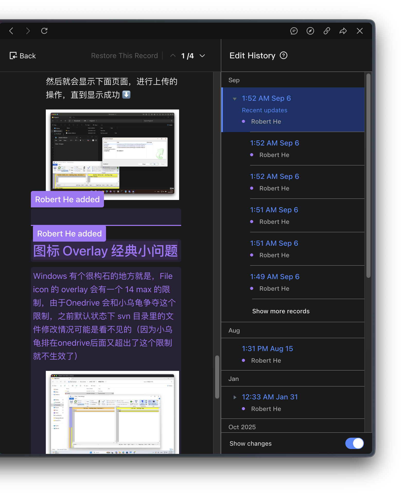
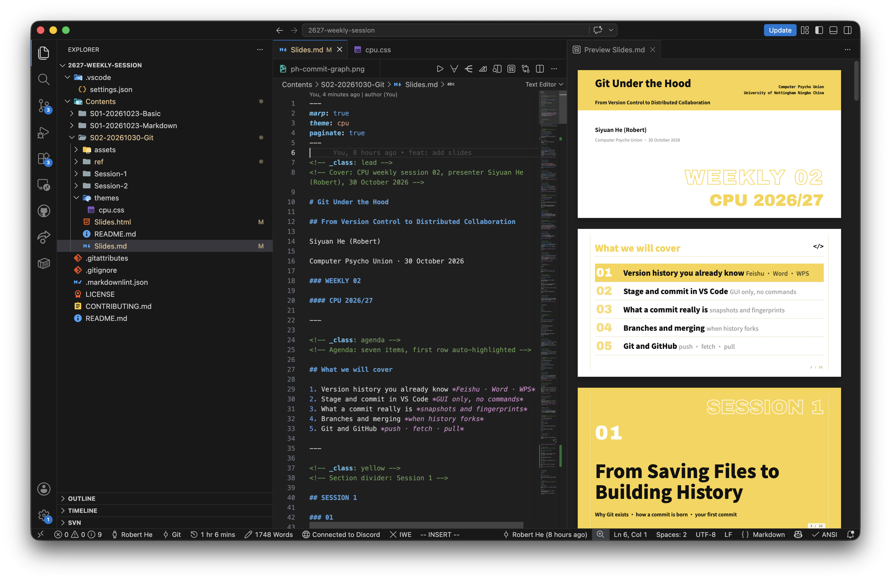
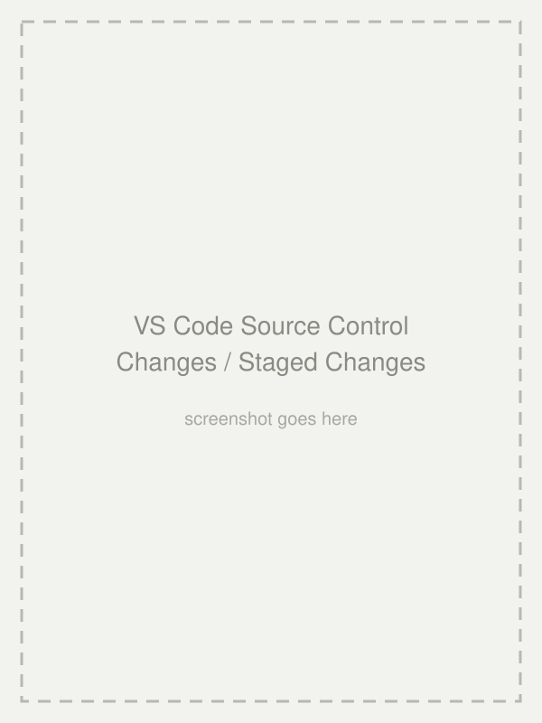
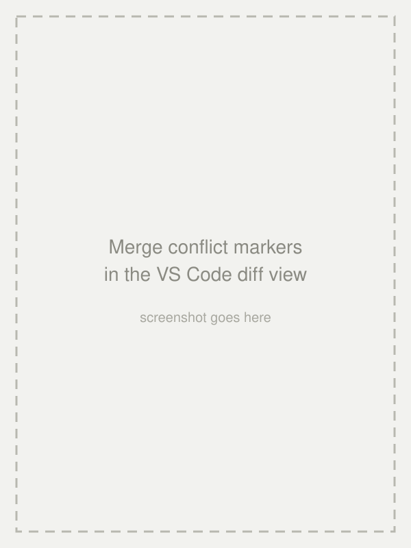
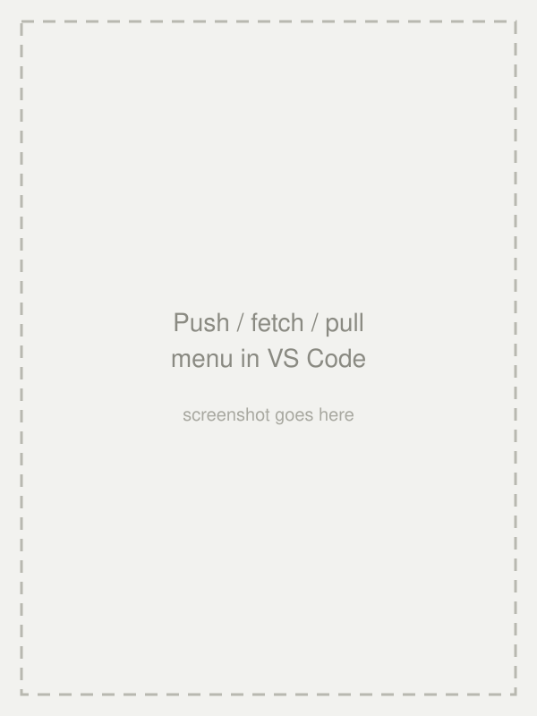

<style>
/* deck-wide: no brand frame on standalone images */
p > img:only-child {
  border: none;
  box-shadow: none;
}

/* every image keeps its natural aspect at the directed size — never
   shrunk or squeezed; larger than the page simply overflows */
img {
  max-width: none;
  max-height: none;
}

/* side-pinned images: vertically centered */
section.side img {
  top: 50%;
  transform: translateY(-50%);
}
</style>

<!-- _class: lead -->
<!-- Cover: CPU weekly session 02, presenter Siyuan He (Robert), 30 October 2026 -->

# Git Under the Hood

## From Version Control to Distributed Collaboration

Siyuan He (Robert)

Computer Psycho Union · 30 October 2026

### WEEKLY 02

#### CPU 2026/27

---

<!-- _class: agenda -->
<!-- Agenda: seven items, first row auto-highlighted -->

## What we will cover

1. Version history you already know *Feishu · Word · WPS*
2. Stage and commit in VS Code *GUI only, no commands*
3. What a commit really is *snapshots and fingerprints*
4. Branches and merging *when history forks*
5. Git and GitHub *push · fetch · pull*

---

<!-- _class: yellow -->
<!-- Section divider: Session 1 -->

## SESSION 1

### 01

#### From Saving Files to Building History

Why Git exists · how a commit is born · your first commit

---

<!-- _class: side -->
<!-- Feishu screenshot is landscape: pinned LEFT (mirrored layout), width directive -->

<style scoped>
section.side {
  padding-left: 640px;
}
section.side img {
  right: auto;
  left: 0;
}
</style>



## 01 · Version history you already know

### THE PANEL YOU NEVER NAMED

Feishu / WPS: open history, restore any autosave, see who changed what.

<br/>

### WORD & POWERPOINT

Autosave plus version history — mistakes become reversible.

<!-- #### YOU KNOW IT -->

---

<!-- Regular content page -->

## 02 · Why code needs its own tool

- **A project is a forest** — hundreds of files and folders, not one document
- **Locked to a product** — offline it is gone, no self-hosting
- **No parallel tries** — no way to keep two versions alive at once
- **Merging** — two people, one file: code auto-merges most of it



*Version control solves the same problem — for code.*

---

<!-- Regular content page -->

## 03 · The old-school way

- `main.py` → `main_old.py` → `main_new.py` → `main_final.py` → `main_final_really_final.py`
- **Copy the folder** — `project_backup_before_refactor/`
- *Which one is real? What changed? How do I go back?*

**Version control manages change and history — not backups.**

---

<!-- Regular content page -->

## 04 · Meet Git (and its ancestor SVN)

- **SVN — centralized** — one server holds the history; offline means stuck
- **Git — distributed** — every clone holds the full history
  - **Born 2005** — Linus Torvalds, built for Linux; today's industry standard

*Centralized vs distributed — the full table in Session 2.*

---

<!-- Regular content page -->

## 05 · Two places, one click

- **Working Tree** — the files you are editing *your desk*
- **Local Repository** — the saved commit history *the archive*
- **Demo** — edit `main.py` · type a message · Commit — a new commit exists

*Saving a file is not recording history. Committing is.*

---

<!-- _class: side -->
<!-- Side image: replace assets/ph-vscode-scm.svg with a real screenshot -->



## 06 · The hidden third place

### THE NEED

Bug fix, new feature, README tweak — commit only the fix.

### THE ANSWER

Stage (+) picks what the next commit contains. Your one-click commit was staging everything silently.

#### STAGE

---

<!-- Regular content page -->

## 07 · Edit, stage, commit

- **Edit** — change files in the editor
- **Stage (+)** — pick what goes into the next commit
- **Commit (check)** — write history with a message
- *Fine-grained: stage single hunks in the diff view*

**A commit is chosen, not dumped.**

---

<!-- Regular content page -->
<!-- .gitignore and .git — replaces the former TODO marker -->

## 08 · Keep some files out of history

- **`.gitignore`** — the list of files Git should pretend not to see *caches · builds · secrets*
- **`.git`** — the hidden folder where the whole history lives *never edit it, never commit it*
- *In VS Code: create `.gitignore` in the repo root — those files vanish from Changes*

---

<!-- Regular content page -->

## 09 · What a commit really is

- **Not** a log of every keystroke
- **A snapshot** — the whole project at that moment
- **Plus a note** — who, when, what and why

*A commit = a snapshot + a message.*

---

<!-- Regular content page -->

## 10 · The commit ID is a fingerprint

- **Same content, same ID** — identical in every clone
- **One character changed, whole ID changes** — tamper-evident
- **No way back from ID to content** — a fingerprint, not a zip

*Hash underneath: SHA-1, or SHA-256 on newer repos — names only.*

---

<!-- Regular content page -->

## 11 · History, bookmarks, you

- **History** — every commit remembers its previous one `A → B → C → D`
- **Branch** — a movable bookmark stuck on a commit *creating one copies nothing*
- **HEAD** — the bookmark you are standing on *VS Code status bar, bottom-left*

*When does the line fork? After the break.*

---

<!-- _class: yellow -->
<!-- Section divider: hands-on -->

## HANDS-ON

### 02

#### Your First Commit

Everyone leaves this room with one commit on their machine

---

<!-- _class: activities -->
<!-- Hands-on steps: four groups -->

## 12 · Fifteen minutes, four steps

### 1 · SIGN IN

Account icon (bottom-left) → Sign in with GitHub → authorize in the browser.

### 2 · INIT

New folder `git-practice` → open in VS Code → Source Control view → click Initialize Repository.

### 3 · COMMIT

Create `main.py` → stage → `Initial commit` → find it in the graph.

### 4 · FEEL THE STAGE

Two files, two commits — you choose what each one contains.

---

<!-- Regular content page -->

## 13 · Before the break

- Why are **stage** and **commit** two separate steps?
- What does a commit store — keystrokes, or a snapshot?
- What are a **branch** and **HEAD**?

*Stuck? Raise a hand, or open an issue in the repo.*

---

<!-- _class: yellow -->
<!-- Break divider -->

## BREAK

### 10

#### MINUTES

Back soon — Session 2 forks from here

---

<!-- _class: yellow -->
<!-- Section divider: Session 2 -->

## SESSION 2

### 03

#### From Branches to Distributed Collaboration

Branches · merging · conflicts · GitHub

---

<!-- _class: side -->


## 14 · When history forks

### SEVERAL LINES AT ONCE

Keep one line stable, try ideas on another.

### FORK AND MERGE

History stops being a line and becomes a graph — a family tree, a river delta.

#### GRAPH

---

<!-- Regular content page -->

## 15 · A branch is just a bookmark

- **Try safely** — new algorithm on the side, the stable line untouched
- **Nothing is copied** — a branch is a movable bookmark, near zero cost
- **In VS Code** — click the branch name (bottom-left) → Create Branch

---

<!-- Regular content page -->

## 16 · Merge: bring lines together

- **Fast-forward** — your line never moved: the bookmark simply slides forward
- **Three-way merge** — both lines moved: base, yours, theirs → one merge commit

---

<!-- _class: side -->
<!-- Side image: replace assets/ph-conflict.svg with a real screenshot -->



## 17 · Conflicts are not errors

### SAME LINES, DIFFERENT WISHES

Git refuses to guess which version you meant.

### YOU DECIDE

Resolve, stage, commit — history moves on.

#### RESOLVE

---

<!-- Regular content page -->

## 18 · Three ways back

- **Discard (undo arrow)** — drop uncommitted changes
- **Unstage (minus)** — take things out of the next commit
- **Revert** — right-click a commit in the graph: a new commit that cancels it

*Git corrects history by adding history.*

---

<!-- Regular content page with table -->

## 19 · Git is not GitHub

| Git | GitHub |
| --- | --- |
| A version control system | A hosting platform for Git repos |
| Runs locally, works offline | Stores remotes, enables sharing |
| Your history lives with you | The meeting place for histories |

- *Committing needs no internet*

---

<!-- Regular content page with table -->

## 20 · Distributed: Git vs SVN

| | SVN | Git |
| --- | --- | --- |
| History lives | one central server | in every clone |
| Commit offline | no | yes |
| Server down | work stops | everyone still commits |

- *SVN era: leave the office network, stop working. Git era: commit on a plane.*

---

<!-- Regular content page -->

## 21 · Remote: who do I sync with?

- A **remote** is a named link to another repository
- `origin` is just the default name — nothing magical
- **VS Code** — Command Palette → Git: Manage Remotes

---

<!-- _class: side -->
<!-- Side image: replace assets/ph-pushpull.svg with a real screenshot -->



## 22 · Push, fetch, pull

### PUSH

Publish your new commits.

### FETCH

See the remote's new commits — your branch stays put.

### PULL

Fetch and integrate — the lines meet again.

#### SYNC

---

<!-- Regular content page -->

## 23 · The whole picture

```text
edit files → working tree → (+ stage) → commit → local repository
                                                      ↓
                                            push · fetch · pull
                                                      ↓
                                                  GitHub
```

- *Everything from today lives somewhere on this line.*

---

<!-- _class: activities -->
<!-- Final exercise: clone / fork / push — mirrors ref Part 7 -->

## 24 · Clone this repo, push to yours

### 1 · CLONE

Command Palette — `Ctrl+Shift+P` (Win) / `Cmd+Shift+P` (Mac) →

"Git: Clone" → paste the repo URL.

### 2 · COMMIT

Make a small change → stage → commit.

---

<!-- _class: activities -->
<!-- Final exercise: clone / fork / push — mirrors ref Part 7 -->

### 3 · PUSH

Click "Sync Changes" → no write permission? → **Create Fork**.

### 4 · CHECK

Visit `github.com/<your-username>` — your commit is there.

*The whole course, one loop: clone → commit → fork → push.*

---

<!-- _class: yellow -->
<!-- Closing page -->

## THANK YOU

### Q&A

#### Start Your History Today

Siyuan He (Robert) · Computer Psycho Union · 30 October 2026

---

<!-- _class: todo -->
<!-- Appendix: force push setting, referenced from the talk -->

## APPENDIX

### ALLOW FORCE PUSH

Settings → search `force push` → enable Git: Allow Force Push.

### STAY SAFE

Keep Use Force Push With Lease on — it refuses to overwrite unseen commits.

- Full course notes — `Contents/S02-20261030-Git/ref/git-ref.md`
