我建议把这门课设计成一门 **“从问题出发，理解 Git 为什么存在、如何使用，以及它在底层如何工作”** 的课程，而不是传统的 Git 命令教学。

面向计算机专业的同学，尤其是还没有系统接触过版本控制的学生，可以把课程分成三个层次：

1. **Why：为什么需要版本管理？** 从飞书文档、Word 的“历史版本”这些每天在用的功能切入，再到代码丢失、版本混乱等真实问题，理解版本控制的设计动机。
2. **How：如何用 Git 解决这些问题？** 介绍最核心的操作——全部通过 VSCode 的图形界面完成，不把课程变成命令手册。
3. **How it works：Git 为什么能做到这些？** 只挑理解工作流所必需的机制（快照、提交历史、分支引用）建立心智模型，刻意跳过对象存储等底层细节。
4. **Hands-on：现场动手。** 每个人在 VSCode 中登录 GitHub 账号、创建仓库并完成自己的第一次提交。

两个 Session 各 50 分钟，建议分别围绕两个问题展开：

- **Session 1：Git 如何记录一个项目的历史？**
- **Session 2：Git 如何管理分支、整合修改，并与 GitHub 协作？**

课程可以使用一个贯穿始终的虚构项目，例如一个 Python 程序。通过几次修改、一次错误修改、一次功能开发和一次历史回溯，逐步引出 Git 的概念。

---

# 一、课程整体框架

## 课程标题

**Git Under the Hood: From Version Control to Distributed Collaboration**

副标题：

*Why Git Exists, How to Use It, and How It Works*

如果希望更偏向学生、轻松一些，也可以使用：

**Git Is More Than `git commit`**

### 课程定位

| 项目 | 设计 |
| --- | --- |
| 目标受众 | 了解基本编程，但没有系统学习过 Git 的大学生 |
| 总时长 | 100 分钟，分为两个 50 分钟的 Session |
| 核心目标 | 理解 Git 的设计动机、核心工作流和基本实现原理 |
| 实践比例 | 约 30%：演示、预测式互动与上机动手（GitHub 登录 + 第一次提交） |
| 教学方式 | 场景故事（从在线文档切入）、可视化示例、VSCode 界面演示、上机动手 |
| 远程部分 | 使用 GitHub 解释 remote、push、fetch、pull（操作均在 VSCode 中完成），不涉及 PR、Issue 等社区功能 |

### 学习目标

完成课程后，同学们应该能够：

1. 解释为什么手动备份和复制项目文件夹不是理想的版本管理方案。
2. 理解 working tree、staging area 和 repository 之间的区别。
3. 在 VSCode 源代码管理视图中完成暂存、提交、查看差异与提交历史，并在课堂上独立完成第一次提交（含 GitHub 登录）。
4. 理解提交、快照、提交 ID 和提交历史等基本概念，能用一句话说出“一次提交记录了什么”。
5. 解释 branch、merge 和冲突的基本含义。
6. 理解 Git 与 GitHub 的关系，以及推送（push）、抓取（fetch）和拉取（pull）的基本作用。
7. 对常见问题建立初步的诊断思路，而不只是记住命令。
8. 使用 `.gitignore` 排除不该进入历史的文件，并知道仓库历史存放在 `.git` 目录中。

---

# 二、Session 1：Git 如何记录一个项目的历史？

**主题：From Saving Files to Building History**

**时长：50 分钟**

这一节应该把更多时间放在设计动机和 Git 的核心模型上。

我不建议一开始就罗列一堆操作。先让学生理解：**我们为什么需要一种专门的工具来记录代码的变化？**

## Part 1 — The Problem: What Does Version Control Actually Solve?（0–10 min）

### 先从你每天在用的“版本管理”说起

不要一上来就讲 Git。先问大家一个问题：

> 飞书文档、金山文档、Word 里那个“历史版本”功能，你用过吗？

你大概率已经享受过“版本管理”，只是没有意识到：

- 飞书 / 金山文档：右上角“历史版本”里躺着每一次自动保存的快照，改坏了可以一键恢复，还能看到谁在什么时候改了什么。
- Word / PPT：自动保存 + 版本历史；在线协作时还能看到别人的修改痕迹。
- 这些功能的共同点：**改错了不怕，随时能回到之前的样子。**

可以现场收集一两个“被历史版本救过”的真实故事，气氛会很好。

一句话概括：

> **“历史版本”记录的就是你中间改了什么东西——Git 要解决的正是同一类问题，只不过对象是代码。**

### 那代码为什么不能直接用它们？

看起来在线文档已经把问题解决了，但把同样的需求放到代码项目上，很快会遇到新情况：

- 代码项目不是一个文件，而是成百上千个文件组成的目录树，文档工具管不住整个文件夹的变化。
- 这些版本功能绑定在特定产品上：离线不可用、没法部署在自己的服务器上、也难和开发工具配合。
- 想同时试验两种方案（比如两个算法各写一版再挑好的），文档工具没有“分支”的概念。
- 多人协作改同一个文件时，代码需要能自动合并大部分修改。

所以程序员需要一个**属于代码的、不依赖某个云服务的版本管理工具**——版本控制系统（Version Control System）。

### 没有专门工具时的土办法

假设你正在开发一个 Python 项目。

第一天，你写出了一个可以运行的版本。

第二天，你增加了一个功能。

第三天，你修改了一个算法，但程序开始出现 Bug。

你会怎么做？

可以先展示几种常见方案：

```text
project/
├── main.py
├── main_old.py
├── main_new.py
├── main_final.py
├── main_final_v2.py
└── main_final_really_final.py
```

这很有趣，但也揭示了几个实际问题：

- **History：** 我们为什么修改了这段代码？
- **Recovery：** 怎样回到某个确定的历史版本？
- **Comparison：** 两个版本究竟有什么区别？
- **Identity：** 哪个文件才是当前真正使用的版本？
- **Experimentation：** 我想尝试一种新算法，但又不想破坏现有版本，怎么办？

接下来可以展示另一种常见做法：把整个项目复制成多个文件夹。

```text
project_backup_1/
project_backup_2/
project_backup_before_refactor/
project_backup_after_refactor/
```

虽然这样比复制单个文件更可靠，但仍然存在很多问题：

- 不容易知道哪些文件发生了变化。
- 不容易准确追踪每一次修改。
- 不容易比较两个版本之间的差异。
- 随着项目规模扩大，备份会越来越笨重。
- 不同版本之间的关系并不清晰。

### 引出 Git（顺带认识一下 SVN）

版本控制系统不止一种。早年的 CVS、SVN 是**集中式**的代表：所有历史放在一台中央服务器上，提交必须连着它——那也是“离开公司网络就干不了活”的时代。Git 则是**分布式**的代表：每个仓库自带完整历史，两者的具体对比放在第二节讲 GitHub 时展开。

Git 由 Linus Torvalds 在 2005 年为开发 Linux 内核而创建，如今几乎是代码版本管理的事实标准。

它的目标不只是帮你保存文件，还要让你能够：

- 记录项目的历史状态。
- 追踪变化。
- 定位历史版本。
- 在不同开发方向之间切换。
- 在不同的开发历史之间整合修改。

**教学重点：在线文档的“历史版本”和 Git 解决的是同一类问题——管理变化和历史；只是代码需要一个更专业、更自由的工具。**

这里先提出问题，不急着讲工具怎么用。

---

## Part 2 — Git's Mental Model: Three Places, Three Different Roles（10–25 min）

这一部分介绍最重要的本地工作流。

我建议把它作为整个课程中第一个需要学生真正理解的模型。讲法上不要一次性陈列三个概念，而是按“需求出现 → 怎么做”的顺序展开：先建立 Working Tree 与 Local Repository 的两区模型，并用 VSCode 的“直接提交”做示范，再用“只提交一部分修改”的需求引出 Staging Area。

### 2.1 先认识两个区域：Working Tree 与 Local Repository

先不要一次摆出所有概念，从一个动作开始：你修改了 `main.py`，并保存了文件。

此时自然出现第一个需求：**怎么把“现在这个状态”保存成一条以后可以回去的记录？**

回答这个需求，只需要两个区域：

| 区域 | 作用 | 可以怎么理解 |
| --- | --- | --- |
| Working Tree | 当前实际编辑的项目文件 | 你的工作台 |
| Local Repository | 已经保存的提交历史 | 项目的历史档案 |

在 VSCode 中演示“从工作台写入档案柜”，看起来只要一步：

1. 修改 `main.py` 并保存，打开源代码管理视图（活动栏中的源代码管理图标，快捷键 Ctrl+Shift+G）。`main.py` 出现在“更改”列表中——这就是工作区的当前状态（`git status` 回答的问题）。
2. 在视图顶部的消息框输入提交信息（例如 `Add input validation`）。
3. 直接点击 **✓**（提交）。“更改”列表清空；打开提交图，可以看到新出现的提交——工作区的状态被写入了本地仓库。

关键在于：**这两个区域不是同一个东西。**

修改文件并保存，只是改变了 Working Tree；只有点击 **✓** 创建提交之后，这个状态才进入 Local Repository 的历史。

不过，这个“直接提交”的一步里其实藏着一点细节——先记住这个疑问，下一节从一个新的需求出发揭晓它。

### 2.2 需求出现：只提交一部分修改——引出 Staging Area

这里值得多花一点时间。

假设你修改了三个文件：

```text
main.py
parser.py
README.md
```

其中：

- `main.py` 修复了一个 Bug。
- `parser.py` 增加了新功能。
- `README.md` 只修改了格式。

你希望先提交 Bug 修复，而不把另外两个修改放进去。

如果没有中间的挑选环节，你可能需要手动复制文件、撤销部分修改，或者想办法把修改拆开。

这正是第三个区域存在的原因——**Staging Area（暂存区，也叫 Index）**：准备纳入下一次提交的内容，可以理解为**下一份提交的草稿**。它位于工作台和档案柜之间：先挑选要归档的内容放进草稿，再统一写入历史。

回头再看上一节的演示：点击 **✓** 时，“更改”列表里还有未暂存的内容，VSCode 其实替你多做了一步——先把它们放进暂存区（对应 `git add`），再创建提交（对应 `git commit`）。暂存区一直都在，只是被“直接提交”的便利藏在了幕后；当你需要只提交一部分修改时，它才走到台前。

在 VSCode 中，这只意味着：只点击 `main.py` 旁边的 **+**（只暂存这一个文件），然后输入 `Fix input validation`，点击 **✓** 提交。

注意，这并不是说其他文件的修改已经消失了。它们仍然可以留在工作区，等待后续处理。

如果需要更细粒度的控制，VSCode 也支持部分暂存：点击“更改”列表中的文件打开差异视图，把鼠标悬停在某个变更块（hunk）上点击 **+**，只暂存这一块；或者先在差异视图中选中部分行，再点击差异编辑器右上角的 **···** → “暂存选定范围（Stage Selected Ranges）”。

这相当于按块、按范围挑选要进入下一次提交的内容。

在这里不需要实际演示所有操作，只需要让学生理解：暂存区不是多余的中间步骤，而是一个有意设计的提交边界。

### 2.3 用一个具体例子验证理解

假设 `main.py` 原本是：

```python
print("Hello")
```

你把它改成：

```python
print("Hello, Git")
```

然后在源代码管理视图中点击 `main.py` 旁边的 **+**，完成暂存。

之后，你又把文件改成：

```python
print("Hello, Git!")
```

最后输入提交信息 `Update greeting`，点击 **✓** 提交。

问题是：提交里会是什么内容？

**答案是：**

```python
print("Hello, Git")
```

因为点击 **+** 的那一刻，当时的文件内容已经进入暂存区，之后的修改不会自动更新暂存区。

这非常适合做一次简短的互动提问。

它能直接帮助学生理解为什么“暂存”和“提交”是两个独立步骤。

### 2.4 需求出现：有些文件不该进入历史

完成几次提交后，很快会发现两类“不该被记录”的东西：

- **环境杂物**——`.DS_Store`、`__pycache__/`、`node_modules/`、编译产物：每次都变，却没有记录价值，只会把历史撑得又大又乱。
- **不想公开的内容**——带密码的配置文件、API key：一旦提交，就进了历史，删掉当前版本也删不掉过去的记录。

这正是 `.gitignore` 存在的原因：在仓库根目录放一个名为 `.gitignore` 的文本文件，写上“不进历史”的名单，Git 就会假装看不见它们：

```text
.DS_Store
__pycache__/
*.pyc
.env
```

在 VSCode 中：资源管理器中新建文件 `.gitignore`（快捷键新建），写好保存——之后“更改”列表里就不会再出现这些文件。GitHub 创建仓库时也提供现成的忽略模板（Python、Node 等），可以直接选用。

顺带回答一个此阶段必然出现的问题：**历史到底存在哪里？** 就在项目根目录那个隐藏的 `.git` 文件夹里——提交、分支、暂存区全部住在里面。日常不需要打开它，更不要手动修改或把它提交进仓库；把它删掉，历史就消失了（只剩工作区里的文件）。

一句话：**`.gitignore` 决定什么不进历史，`.git` 装着全部历史。**

### 本部分的核心结论

```text
Edit → Stage → Commit
```

它们分别对应：

```text
修改文件 → 选择提交内容 → 创建历史记录
```

在 VSCode 中，这三步分别对应：在编辑器中修改文件 → 源代码管理视图中点击 **+** → 输入提交信息后点击 **✓**。

建议让学生把这个模型记住，而不是先记住十几个操作。

---

## Part 3 — What Is a Commit, Really?（25–33 min）

这一部分只回答一个问题，点到为止，不展开内部实现。

先问学生：

> 当你在 VSCode 中点击 **✓** 创建一次提交时，Git 究竟保存了什么？

很多初学者会认为 Git 主要记录每一次修改的操作，例如：

```text
1. 在第 3 行增加一个函数
2. 删除第 5 行
3. 修改变量名
```

但 Git 的做法更简单直接：**每次提交，保存项目在这一刻的完整状态（一份快照），再附上一条说明。**

一句话概括：

> **一次提交 = 一份项目快照 + 一条“这次我改了什么、为什么改”的说明。**

例如，Commit A 记录的是：

```text
main.py
utils.py
README.md
```

这三个文件在那一刻的样子。你修改了 `main.py` 后创建 Commit B，它记录的又是新一刻的完整样子。

每次提交还会自动附上：作者、时间、你填写的提交说明，以及一个像指纹一样的提交 ID（比如 `a1b2c3d`）。

提交 ID 来自一次**哈希（hash）运算**：把内容交给一个固定的函数，算出一串定长的字符串。不需要了解算法本身，记住哈希的三个特性就够用：

- **同样的内容，算出的 ID 一定相同。** 所以两处出现同一个 ID，就说明内容完全一致。
- **内容哪怕只改一个字符，ID 也会整个变掉。** 所以 ID 没变，内容就没被悄悄改动过——相当于自带“防篡改封条”。
- **没法从 ID 反推出内容。** 它是内容的“指纹”，不是“压缩包”。

顺带一提：Git 传统上使用 SHA-1（40 位十六进制），新仓库也支持 SHA-256——知道名字即可。

至于快照在磁盘上具体怎么存、相同的文件如何复用，属于 Git 的内部实现，这节课刻意不讲。你只需要记住：

> Git 记录的是“项目每个时刻长什么样”，而不是“你敲过的每一步操作”。

---

## Part 4 — History, References, and "Where Am I"?（33–41 min）

这一部分为第二节做铺垫，只保留三个最实用的结论：历史是一条链、分支是一张书签、HEAD 标记你现在的位置。

### 4.1 提交连成一条历史

每创建一次提交，它都会接在上一次提交的后面，于是项目历史像一条链一样不断向前生长：

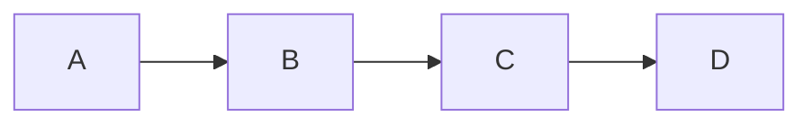

一句话概括：**每个提交都记得自己的“上一个”是哪个提交，所以历史能一路追溯回起点。**

到目前为止，这条线都是直的。它什么时候会“岔开”？岔开之后又怎么合回来？——这是第二节的开场问题，先卖个关子。

### 4.2 分支：一张写着“当前进展”的书签（Reference）

仓库里可以同时存在很多提交，Git 需要一种方式标记“值得指认的那些提交”。答案是引用（reference）：**一张贴在某个提交上、可以随时挪动的“书签”**。

例如：

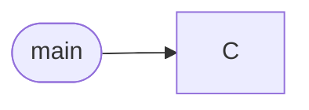

`main` 就是这样一个引用，此刻指向提交 C。

当你在 `main` 上创建新提交 D 时，Git 不需要改动任何历史，只要把这个引用移动到 D：

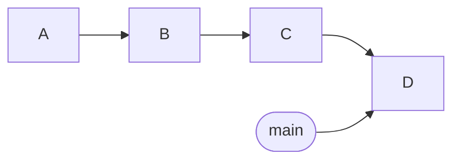

这也是 Git 中分支非常轻量的原因之一。

分支并不是把整个项目复制一份，而是一个指向提交的可移动引用。

一句话：**分支就是贴在某个提交上的书签，创建和移动它几乎零成本。**

### 4.3 还剩一个问题：你本人现在在哪个分支上？

分支和引用都可以有很多个，于是还剩最后一个问题：**你本人现在站在哪个分支上？** 换句话说，下次点击 **✓** 创建的提交会落到哪个分支？

Git 用一个特殊标记回答：`HEAD` 表示当前检出的版本位置，通常通过当前分支引用间接指向一个提交。

例如：

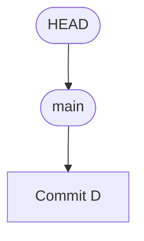

如果你切换到另一个分支，`HEAD` 的位置也会随之改变——VSCode 状态栏左下角显示的分支名，反映的正是 `HEAD` 当前所在的分支。

一句话：**HEAD 就是“你现在站在哪”的标记。**

这里可以只介绍概念，不必深入 detached HEAD 等特殊状态。

### Session 1 核心结论

- 一次提交 = 项目快照 + 一条“改了什么”的说明。
- 提交连成历史，分支是书签，HEAD 标记你现在的位置。

记住这三句话，第二节的一切都会顺理成章。

---

## Part 5 — 动手环节：登录 GitHub，完成第一次提交（41–50 min）

这一部分留出真正的上机时间，目标只有一个：**每个人现场完成自己的第一次提交。**（原来的“查看历史”演示融合在动手步骤里。）

### 5.1 准备：在 VSCode 中登录 GitHub（约 3 分钟）

1. 点击 VSCode 左下角的账户头像图标 → “使用 GitHub 登录（Sign in with GitHub）”。
2. 浏览器会打开 GitHub 授权页面，登录并点击 **Authorize visual-studio-code**。
3. 回到 VSCode，账户图标处显示你的 GitHub 用户名/头像，即登录成功。

登录之后，VSCode 可以直接以你的身份发布、克隆仓库——第二节推送时不再需要现场折腾认证。

### 5.2 创建仓库并完成第一次提交（约 5 分钟）

1. 新建文件夹 `git-practice`，在 VSCode 中打开：文件 → 打开文件夹。
2. 命令面板（F1）→ “Git: 初始化仓库”。
3. 新建 `main.py`，写一行 `print("hello, git")` 并保存——文件立刻出现在源代码管理视图的“更改”列表里。
4. 消息框输入 `Initial commit`，点击 **✓**。
5. 打开提交图（**···** → “查看提交图”），找到自己刚创建的第一个提交；点击“更改”里的文件还能打开差异视图。

### 5.3 再来一次，体会暂存区（约 1 分钟，时间允许时）

- 修改 `main.py`，再新建一个 `notes.md`。
- 这次先只点 `main.py` 旁的 **+** 暂存并提交，再单独暂存提交 `notes.md`。
- 提交图里出现两次提交——这就是“自己挑选下一次提交包含什么”。

### 5.4 下课前三个问题

1. 为什么“暂存”和“提交”是两个不同的步骤？
2. 一次提交里保存的是什么——是你的每一步操作，还是项目那一刻的样子？
3. 分支和 HEAD 分别是什么？

最后用一句话收束：

> Git records snapshots, connects them into history, and gives us ways to navigate that history.

走动帮同学排障，常见问题：GitHub 没登录成功、文件夹没有在 VSCode 中打开、误把整个主目录初始化成仓库。没跟上的同学可以课后照着 5.1–5.2 补齐，或到仓库 issue 提问。

---

# 三、Session 2：Git 如何管理分支、整合修改，并与 GitHub 协作？

**主题：From Branches to Distributed Collaboration**

**时长：50 分钟**

第二节建议从一个实际的开发需求出发：

> 你已经有一个可以运行的版本。现在，你想尝试一种新算法，但不想破坏现有代码。

由此自然引出 branch、merge、冲突，以及 remote。

## Part 1 — Graph, and Why Do We Need Branches?（0–8 min）

### 1.0 前奏：历史什么时候会变成一张“图”？

第一节里，我们看到的提交历史都是一条直线：新提交接在旧提交后面，一路向前。

但真实的开发常常需要**几条线同时推进**：一条保持稳定可用，另一条拿去做试验。一旦几条线从同一个版本出发各自延伸、之后又汇合，历史就不再是一条线，而是一张会**分叉和汇合的图（Graph）**——像家谱，也像河流的分叉与合流：

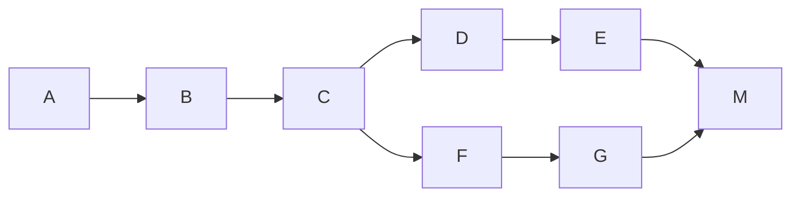

第二节的所有主角——分支、合并、冲突、撤销——都是在这张图上发生的故事。先从“为什么需要岔出一条线”讲起。

### 1.1 没有分支会发生什么？

假设项目历史如下：

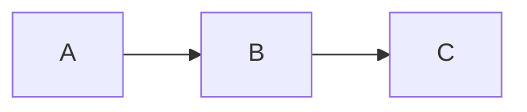

现在你想增加一个新功能。

一种方法是在当前版本上直接修改：


但如果你不确定这个功能能否成功，就会面临一个问题：

**如何在保留现有稳定版本的同时，安全地尝试新方案？**

如果每次尝试都复制整个项目，会出现之前讨论过的问题。

Git 的分支允许你在现有历史基础上创建另一条开发路径。

### 1.2 Branch 是什么？

满足这个需求的方案，就是在现有历史基础上分出一条可以独立推进的开发路径。例如：


这个图表示：

- `main` 仍然指向 C。
- `feature` 指向 E。
- 两个分支共享之前的历史，但后续提交可以不同。

历史在这里第一次“岔开”——正是前奏里那张图的最小版本：一条线停在 C，另一条继续走到 E。

分支的重点是：**允许不同的开发路径独立推进，而不必复制整个仓库。**

### 1.3 在 VSCode 中创建和切换分支

在 VSCode 中，分支操作集中在**状态栏左下角的当前分支名**上：

- 点击分支名，在弹出的下拉列表中选择已有分支，即可切换到该分支。
- 选择“创建新分支...”，输入 `feature` 并回车，一步完成“创建 + 切换”。

这里可以解释一个容易被误解的地方：

**创建分支本身不会创建一个新的提交，也不会立即复制一份项目。**

它主要是在 Git 中创建一个新的分支引用。

可以把这看作一个非常轻量的操作。

---

## Part 2 — Merge: How Do We Bring Histories Together?（8–20 min）

分支解决了独立开发的问题，但当功能开发完成后，我们往往需要把修改整合起来。

这就引出了 merge。

### 2.1 一个简单的合并场景

假设：

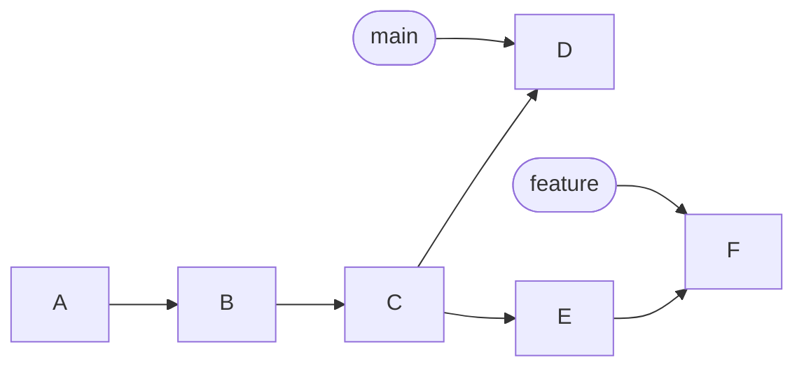

其中：

- `main` 指向 D。
- `feature` 指向 F。
- C 是两个分支的共同祖先。

现在你希望把 `feature` 的开发成果合并到 `main`。

Git 会根据提交历史和文件内容来判断如何完成整合。

### 2.2 Fast-forward 与三方合并

可以介绍两种常见情况。

**情况 A：Fast-forward**

假设 `main` 仍然指向 C，而 `feature` 已经前进到 E：

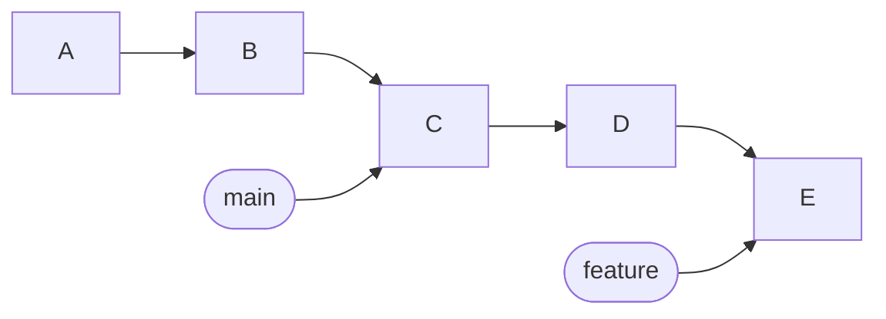

当切换到 `main` 并合并 `feature` 时，如果 `main` 没有独立的新提交，Git 可以直接把 `main` 引用移动到 E。

这就是 fast-forward。

它不需要创建新的合并提交。

**情况 B：Three-way merge**

如果 `main` 和 `feature` 都产生了独立提交：

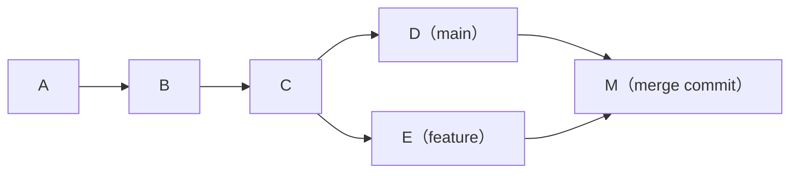

Git 可以使用三个版本进行合并：

1. 共同祖先 C。
2. `main` 上的版本 D。
3. `feature` 上的版本 E。

这就是三方合并的基本思路。

Git 不只是把两个文件直接拼在一起，而是利用共同祖先和两个分支的变化来尝试整合修改。

### 2.3 为什么会发生 Merge Conflict？

现在假设两个分支都修改了同一个函数：

```python
def calculate_price(price):
    return price * 1.0
```

`main` 修改为：

```python
def calculate_price(price):
    return price * 1.1
```

`feature` 修改为：

```python
def calculate_price(price):
    return price * 1.2
```

Git 无法确定开发者究竟希望采用哪一种业务逻辑。

因此，它可能产生冲突，需要开发者决定最终结果。

关键点是：

**冲突不一定意味着 Git 失效，而可能意味着 Git 缺乏足够的信息来判断开发者的真实意图。**

Git 可以处理大量结构清晰、没有歧义的修改；但它无法仅凭代码差异理解所有业务语义。

### 2.4 冲突是否只会发生在同一行？

不一定。

同一行的不同修改很容易产生冲突，但不同位置的修改也可能发生冲突。

例如：

- 一方删除了某个函数，另一方修改了这个函数。
- 一方重命名文件，另一方修改了旧文件。
- 一方修改了公共接口，另一方新增的代码依赖旧接口。

这里可以把冲突理解为：**自动整合无法可靠地确定最终结果，需要人为介入。**

---

## Part 3 — Undo: Git Can Go Back, but What Does “Back” Mean?（20–30 min）

这一部分很适合用来解释 Git 的历史模型有什么实际价值。

学生可能会问：

> 如果我提交了一次错误修改，能不能撤销？

答案是可以，但不同的撤销操作针对的是不同层次。

### 3.1 先区分三个问题

| 问题 | VSCode 中的操作 |
| --- | --- |
| 我修改了文件，但还没有暂存，想丢弃这些修改 | 源代码管理视图中悬停该文件 → 点击 **↩**（放弃更改） |
| 我已经暂存了修改，但还没有提交，想取消暂存 | 在“暂存的更改”中点击 **−**（取消暂存） |
| 我已经提交了错误修改，想创建一个反向修改 | 在提交图中右键该提交 → “还原提交（Revert Commit）” |

对于最后一种情况，最值得向初学者介绍的是**还原提交（revert）**：在提交图中右键目标提交，选择“还原提交”（如果你的提交图右键菜单中没有该选项，可以安装 Git Graph 扩展，同样是右键 → Revert Commit）。

它会创建一个新的提交，用于撤销指定提交所引入的修改。

例如：

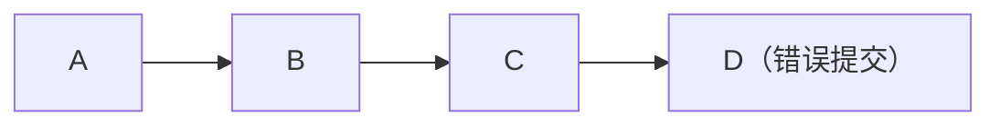

假设 D 是一次错误提交。

对 D 执行“还原提交”后，历史会继续向前：

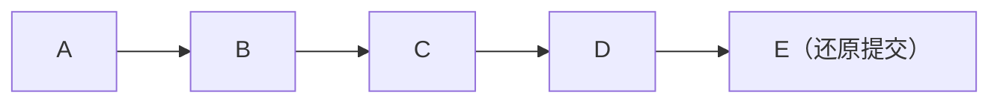

E 是一个新提交，其作用是反向撤销 D 的修改。

**Git 通常不需要通过删除历史来纠正历史。**

这也解释了为什么历史记录不仅是备份，还可以成为团队理解代码变化的依据。

### 3.2 那 `git reset` 呢？

可以简单提及，但不必展开操作细节。

`git reset` 可以移动当前分支引用，并根据参数改变暂存区或工作区状态。

它与还原提交（revert）的核心区别在于：

- `revert` 通过新提交撤销先前的变化。
- `reset` 可以改变当前分支所指向的提交，并可能影响暂存区和工作区。

对于初学者，建议先记住：

> 如果已经把提交共享给其他人，通常优先考虑还原提交（revert），而不是随意重写共享历史。

不需要在这节课中深入 `reset --soft`、`--mixed`、`--hard` 的区别。

---

## Part 4 — What Does “Distributed” Mean?（30–40 min）

这一部分是从本地 Git 过渡到 GitHub 的关键。

先提出一个问题：

> 如果 Git 已经能在本地保存历史，为什么还需要 GitHub？

### 4.1 Git 和 GitHub 不是同一个东西

可以先给出一个简单对比：

| Git | GitHub |
| --- | --- |
| 一个版本控制系统 | 一个提供 Git 仓库托管等服务的平台 |
| 可以在本地运行 | 可以托管远程仓库 |
| 可以记录提交、管理分支、整合历史 | 可以保存远程仓库，便于跨设备或多人共享 |
| 不要求必须使用 GitHub | 可以托管 Git 仓库，但不等于 Git 本身 |

例如，你完全可以在没有网络的情况下，只用 VSCode 完成：

1. 命令面板（F1）→ “Git: 初始化仓库”，在当前文件夹创建仓库。
2. 在源代码管理视图点击“更改”标题栏的 **+**（暂存所有更改）。
3. 输入提交信息 `Initial commit`，点击 **✓** 提交。

这些操作不需要 GitHub。

因此，GitHub 不是 Git 的必要组成部分。

### 4.2 为什么 Git 是分布式版本控制系统？

看一个具体场景。假设有两名开发者：

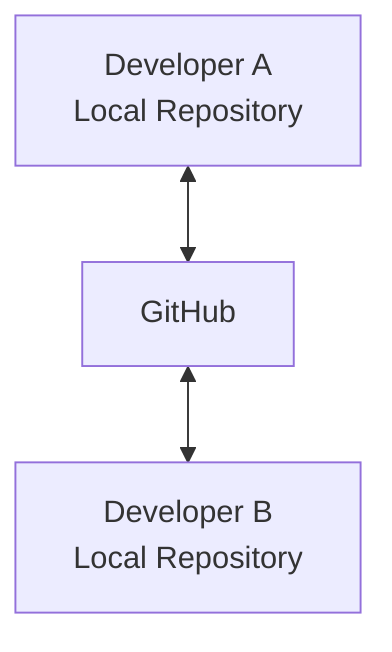

A 和 B 都可以在本地创建提交、查看历史、切换分支——哪怕此刻完全没有网络。

为什么做得到？关键区别是：**每个正常克隆得到的仓库都自带完整的提交历史，而不只是文件的一份副本。** 他们各自手里都有一个功能完整的仓库。

这也正好回答了第一节埋下的问题：Git 和更早的 SVN 有什么区别？

| | SVN（集中式） | Git（分布式） |
| --- | --- | --- |
| 历史存在哪里 | 只在中央服务器 | 每个克隆都有完整历史 |
| 提交需要联网吗 | 必须连着中央服务器 | 不需要，本地随时提交 |
| 中央服务器宕机 | 所有人无法提交、无法协作 | 每人手里仍有完整仓库，之后随便挑一份同步 |
| 典型协作方式 | 围绕中央仓库转 | 任意仓库互相同步，GitHub 是最流行的“汇合点” |

一句话：**SVN 时代离开公司网络就干不了活；Git 时代飞机上也能写代码提交。**（较真备注：浅克隆等特殊配置下本地不一定有全部历史，这里按普通完整克隆讨论。）

### 4.3 需求出现：本地仓库怎么记住“要和谁同步”？——引出 Remote

本地有了完整历史之后，新需求出现了：把提交发布到 GitHub，或者拿到别人的更新。这要求本地仓库先记住“要打交道的远程仓库是谁、地址是什么、给它叫什么名字”。

这就是 remote：一条命名的远程仓库连接配置。

在 VSCode 中，命令面板（F1）→ “Git: 管理远程仓库（Manage Remotes）”即可查看已配置的远程仓库及其地址，也可以在这里添加或修改。

克隆 GitHub 仓库时：命令面板（F1）→ “Git: 克隆（Clone）”，粘贴仓库地址并选择本地存放路径。

Git 会在本地创建一个仓库，并通常将来源仓库配置为名为 `origin` 的 remote。

这里要强调：

**`origin` 只是一个常见的默认名称，不是 GitHub 的特殊关键字。**

一个 remote 可以关联到 GitHub，也可以关联到公司内部的 Git 服务器，甚至是另一台电脑上的仓库。

---

## Part 5 — Push, Fetch, Pull: What Actually Moves?（40–47 min）

这是远程部分最重要的知识点。

我建议把它讲成三个先后出现的问题，而不是让学生死记操作：

1. 我在本地完成了提交，怎么发布出去？（push）
2. 远程有没有别人的新提交？（fetch）
3. 远程更新拿到后，怎么整合进当前分支？（pull）

### 5.1 Push：把本地提交发布到远程仓库

第一个问题：我在本地完成了一些提交，怎么让别人、让 GitHub 也看到？

在 VSCode 中：第一次推送时，点击状态栏的“发布分支（Publish Branch）”；之后可以点击“同步更改”，或通过源代码管理视图 **···** → “拉取、推送” → “推送（Push）”。

概念上，它会将远程仓库尚未拥有的必要 Git 对象传过去，并更新远程引用，但具体更新还会受到目标分支、权限和服务器规则等因素影响。

如果推送被拒绝、而你确实需要覆盖远程历史（例如自己整理过提交），参见文末附录《在 VSCode 中允许 Force Push》。

### 5.2 Fetch：获取远程的新信息

第二个问题：别人可能已经往远程推送了新提交，我怎么知道？

在 VSCode 中：源代码管理视图 **···** → “拉取、推送” → “抓取（Fetch）”。

它会获取远程的新提交和相关对象，并更新相应的远程跟踪引用。

例如：

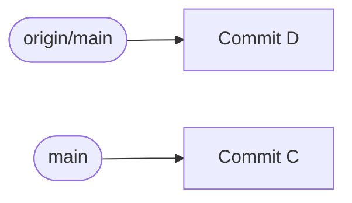

执行抓取后，Git 可能发现远程 `main` 已经前进到 D。

此时，本地的 `origin/main` 会更新到 D，但本地 `main` 不会因此自动移动。

这说明：

**获取远程更新，不等于把远程更新直接整合进当前工作分支。**

### 5.3 Pull：获取并整合

第三个问题：远程的更新拿到了，怎么把它整合进我当前的工作分支？

在 VSCode 中：源代码管理视图 **···** → “拉取（Pull）”，或直接点击“同步更改（Sync Changes）”按钮（一次完成拉取 + 推送）。

在常见配置下，拉取可以理解为：

```text
抓取（fetch） + 整合（integrate）
```

后半部分通常是 merge，也可以根据配置使用 rebase。

例如：

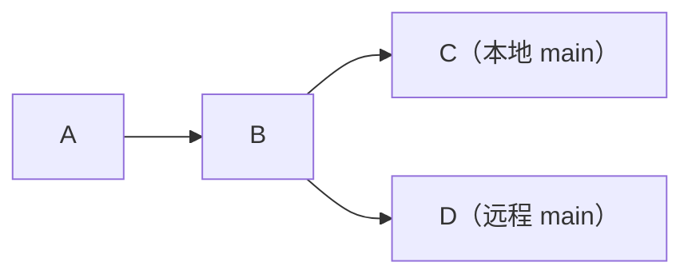

执行拉取后，Git 会先获取远程更新，再按照配置尝试整合远程历史。

如果本地没有独立的新提交，可能只是 fast-forward。

如果本地和远程分别产生了提交，则可能需要 merge 或 rebase。

### 5.4 一个适合课堂的记忆方法

| VSCode 中的入口 | 核心含义 |
| --- | --- |
| 发布分支 / 推送 | 把本地提交发布到远程 |
| 抓取 | 获取远程更新，但不自动整合进当前分支 |
| 拉取 / 同步更改 | 获取远程更新，并尝试整合 |

需要提醒学生：不要把“拉取”理解为简单地“下载文件”。

Git 处理的是仓库对象、引用和提交历史之间的同步与整合。

---

## Part 6 — Putting It Together: A Complete Mental Model（47–50 min）

最后用一张图将整门课的内容串起来。

可以用以下流程总结：

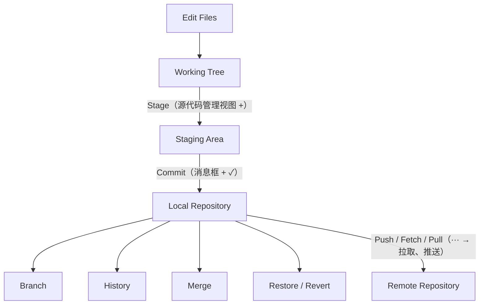

最后强调三点：

1. **Git 的核心是管理历史。** 文件是工作对象，提交和提交之间的关系构成了历史。
2. **Git 的分支是轻量的历史引用。** 它使不同的开发路径可以独立推进，再通过合并整合。
3. **Git 是分布式的。** GitHub 提供远程仓库托管和共享能力，但 Git 本身就可以在本地独立工作。

---

# 四、如何把“设计初衷”融入课程，而不是单独讲历史？

我建议不要单独拿出十分钟讲 Git 的发展史。

更有效的方式是让每一个重要功能都回答一个设计问题。

| 设计问题 | 引出的概念 | 学生应该理解什么 |
| --- | --- | --- |
| 在线文档的“历史版本”够用吗？ | Version Control Motivation | 解决的是同一类问题，但代码需要更专业、更自由的工具 |
| 为什么不能只复制文件夹？ | Version Control | 需要系统化地记录变化和历史 |
| 为什么“暂存”和“提交”分开？ | Staging Area | 提交应该是经过选择的、有明确边界的变化集合 |
| 为什么提交 ID 像指纹？ | 内容派生的 ID | 内容一样 ID 就一样，不会撞车也无需中央发号 |
| 提交怎么连成历史？ | Commit Chain / Graph | 历史可以被追踪、分叉和整合 |
| 为什么分支可以很轻量？ | Branch References | 分支主要是指向提交的引用，不是项目副本 |
| 为什么会有 Merge Conflict？ | Three-way Merge | Git 可以整合内容变化，但无法保证推断出所有语义意图 |
| 为什么 Git 不需要中央服务器来创建提交？ | Distributed VCS | 每个本地仓库都可以独立管理自己的历史 |
| 为什么还需要 GitHub？ | Remote Repository | 远程仓库让不同设备和开发者能够交换、共享历史 |

这种安排会让课程更连贯。

学生不是在记忆一堆功能，而是在逐渐理解：**Git 的各个功能是如何回应真实的软件开发问题的。**

---

# 五、哪些内容应该讲，哪些应该刻意不讲？

如果只有 100 分钟，我建议严格控制范围。

## 建议重点讲解

| 内容 | 深度 |
| --- | --- |
| 为什么需要版本控制 | 详细 |
| Working Tree / Staging Area / Repository | 详细 |
| 暂存、提交、查看状态与差异（源代码管理视图） | 理解并演示 |
| `.gitignore` 与 `.git` 目录 | 知道用途即可 |
| 一次提交 = 快照 + 说明 | 一句话概括 |
| 提交 ID 像指纹 | 点到为止 |
| 提交图（Graph）：历史的分叉与汇合 | 第二节作为分支前奏讲清 |
| 动手：GitHub 登录 + 第一次提交 | 现场完成 |
| Branch 与 HEAD | 详细 |
| Merge 与 conflict | 详细 |
| 放弃更改与还原提交（restore / revert） | 了解常见使用场景 |
| Git 与 GitHub 的区别 | 详细 |
| Remote 与推送、抓取、拉取 | 详细 |

## 建议只提及，不深入

| 内容 | 原因 |
| --- | --- |
| SVN 与集中式版本控制 | 一张对比表带过即可 |
| blob / tree 等内部对象、去重存储 | 与日常使用无关，刻意不讲 |
| Rebase 的详细操作 | 容易把课程带入复杂的历史改写场景 |
| Cherry-pick | 与本课的核心心智模型关系较弱 |
| `reset --soft`、`--mixed`、`--hard` | 初学者容易混淆工作区、暂存区和历史变化 |
| Interactive rebase | 需要额外解释提交重写与历史整理 |
| Submodule、Subtree | 属于更进阶的仓库管理问题 |
| Git Hooks | 与当前目标关系不大 |
| GitHub Pull Requests、Issues、Actions | 属于平台工作流，不是理解 Git 基础所必需的内容 |
| GitHub 的权限、组织与社区功能 | 超出当前课程范围 |

尤其不建议把第二节变成“Git 常用命令大全”。分支、合并、远程同步之间有一条清晰的逻辑链，沿着这条逻辑讲会更有效。

---

# 六、实践如何安排：预测式互动 + 上机动手

实践分两类：

- **Predict Before You Execute**：每次演示之前，先给出当前状态，让学生预测 Git 会发生什么，再揭晓答案。
- **上机动手**：Session 1 末尾的 Part 5，人人完成 GitHub 登录和第一次提交（认证问题提前在 5.1 排掉，动手中不再被卡住）。

下面的互动以预测式为主，穿插在讲授中。

## 互动 1：点击 + 到底暂存了什么？

**时间：2 分钟**

初始内容：

```python
print("Hello")
```

操作顺序（全部在 VSCode 中完成）：

1. 将文件修改为 `print("Hello, Git")`。
2. 在源代码管理视图中点击 `main.py` 旁的 **+**（暂存）。
3. 再把文件修改为 `print("Hello, Git!")`。
4. 输入提交信息 `Update greeting`，点击 **✓** 提交。

提问：

> 提交里保存的是哪一个版本？

考察 staging area 的概念。

## 互动 2：分支到底复制了什么？

**时间：2 分钟**

展示：

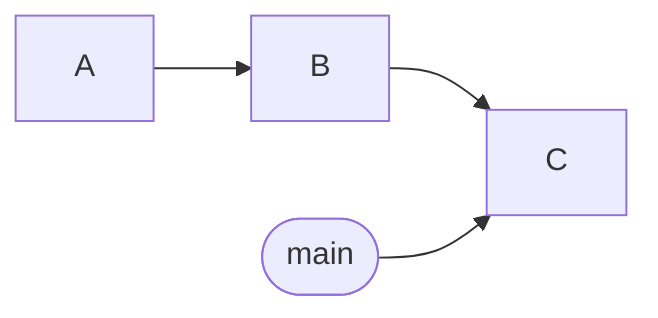

操作：点击状态栏左下角的分支名 → “创建新分支...” → 输入 `feature`（VSCode 创建后会自动切换到新分支）。

提问：

- 是否生成了一个新的 commit？
- 是否复制了整个项目？
- 新分支指向哪里？

考察 branch reference 的概念。

## 互动 3：为什么 Merge 会产生冲突？

**时间：3 分钟**

展示两个分支分别把：

```python
timeout = 10
```

修改为：

```python
timeout = 20
```

和：

```python
timeout = 30
```

提问：

> Git 应该选择 20 还是 30？

让学生先判断，再解释冲突的本质。

## 互动 4：Fetch 和 Pull 有什么区别？

**时间：3 分钟**

展示：

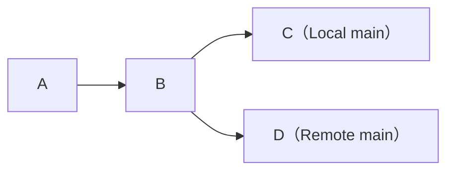

提问：

> 在 VSCode 中点击“抓取”后，本地的 `main` 会不会自动指向 D？

接着再解释 remote-tracking branch 和 pull。

**总计约 10 分钟。** 其余演示可以由讲师操作，不要求学生从零配置仓库。

---

# 七、推荐的最终时间表

如果需要直接拿去制作 PPT，可以采用下面这个版本。

## Session 1 — Git's Local Model and First Commit

| 时间 | 模块 | 核心内容 |
| --- | --- | --- |
| 0–10 min | The Problem | 飞书/Word 的历史版本；代码为什么需要专门工具；SVN 一句带过 |
| 10–25 min | The Three Areas | Working Tree、Staging Area、Repository；暂存与提交；`.gitignore` 与 `.git` |
| 25–33 min | What Is a Commit? | 快照 + 说明；提交 ID 像指纹 |
| 33–41 min | History and References | 提交链、分支书签、HEAD |
| 41–50 min | Hands-on | GitHub 登录、初始化仓库、第一次提交；三个收尾问题 |

## Session 2 — Branching, Merging and Remote Repositories

| 时间 | 模块 | 核心内容 |
| --- | --- | --- |
| 0–8 min | Graph and Branches | 提交图：分叉与汇合；独立开发、分支的轻量机制 |
| 8–20 min | Merge and Conflicts | Fast-forward、三方合并、冲突原因 |
| 20–30 min | Undo | 放弃更改、还原提交；简要提及 reset |
| 30–40 min | Distributed Git | Git 与 GitHub 的区别；SVN 对比；remote 的概念 |
| 40–47 min | Push, Fetch and Pull | 远程对象、引用更新和历史整合 |
| 47–50 min | Final Mental Model | 回顾完整工作流 |

---

# 八、PPT 的叙事顺序建议

最后还有一个设计建议：**尽量让每一页 PPT 只回答一个问题。**

你可以把整门课设计成一条连续的故事线：

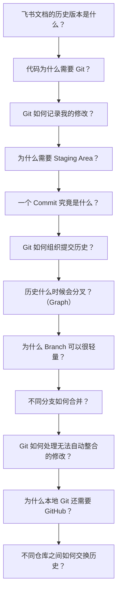

建议每个模块都采用类似的讲解顺序：

1. **Problem**：先展示一个具体问题。
2. **Idea**：解释 Git 为什么采用这种设计。
3. **Mechanism**：用图解释其工作原理。
4. **Usage**：展示一到三个对应的 VSCode 操作。
5. **Prediction**：让学生预测执行后会发生什么。

这样能够避免课程退化为命令教学，也能让底层原理始终与实际使用场景对应。

**如果只能保留一个核心教学原则，那就是：先解释 Git 需要解决什么问题，再介绍它提供了什么机制，最后才演示对应的 VSCode 操作。** 对计算机专业学生而言，这种组织方式更容易建立长期有效的理解，而不只是让他们在课后记住几条命令。

---

# 附录：在 VSCode 中允许 Force Push

默认情况下，VSCode **禁用**强制推送：当本地历史与远程分叉（例如回退或整理过提交）后，普通推送会被远程拒绝，而且界面上根本找不到强制推送的入口。需要先在设置中显式开启。

## 为什么默认禁用

Force push 会用本地历史**直接覆盖**远程分支历史。如果其他人已经基于远程的旧历史开始了工作，他们本地的历史会与远程“脱节”，必须额外修复。因此 VSCode 把它默认关闭，避免误操作。

## 开启步骤

1. 打开设置：`Ctrl+,`（macOS 为 `Cmd+,`），或命令面板（F1）→ “首选项: 打开设置”。
2. 搜索 `force push`。
3. 勾选 **Git: Allow Force Push**（对应设置项 `git.allowForcePush`）。
4. 建议同时保持勾选 **Git: Use Force Push With Lease**（对应 `git.useForcePushWithLease`，默认开启）。开启后，VSCode 的“强制推送”默认使用 `--force-with-lease`：如果远程分支在你不知情的情况下又有了新提交，推送会失败而不是直接覆盖，更安全。

等价的 `settings.json` 写法：

```json
{
  "git.allowForcePush": true
}
```

## 如何使用

开启设置后，强制推送入口才会出现：

- 源代码管理视图 **···** → “拉取、推送” → “强制推送（Force Push）”；
- 或命令面板（F1）→ 输入 “强制推送”，可以选择具体变体（例如 Force Push、Force Push (With Lease)）。

## 教学提醒

向学生演示时建议强调两条原则：

1. 先尝试普通推送；只有明确知道远程历史为何分叉（例如自己整理过提交）时，才考虑强制推送。
2. 优先使用 `--force-with-lease` 变体，避免覆盖他人在远程的新提交。
